# 工单系统（Ticket / Work Order）分析与设计建议

> 状态：**P0 已实现（2026-11-01），P1 Wave 1/2/3 已实现（2026-11-02）**；实现契约见 `docs/design/ticket-implementation-contract.md` 与 `docs/design/ticket-p1-contract.md`，代码与验证结果见 §10.1、§10.2、§13。
> 适用：`room_node_backend` / Room Node Console
> 配套材料：后端现状盘点 `docs/design/_tickets-backend-inventory.md`、前端现状盘点 `docs/design/_tickets-frontend-inventory.md`、可交互原型 `prototype/tickets/`、真实页面截图 `docs/design/ticket-implementation-*.png`
> 结论先行：**上线前确实没有工单系统，但系统已经具备了几乎所有“信号”；这次补齐的不是告警系统，而是“谁负责、处理到哪、如何复盘”这层很薄的人工闭环。**

---

## 0. 先回答你的问题

| 你的问题 | 结论 |
| --- | --- |
| 这套系统有工单系统吗？ | **没有。** 全仓 `ticket / 工单 / work_order` 零命中，迁移 `0001`–`0017`、权限点、后台路由都没有工单概念。现在有的是机器健康、设备上下线、事件投递、资源分发这些**信号**，以及审计日志这种**事后记录**。 |
| 那需要什么样的工单？ | 轻量工单：**一张工单表 + 一个状态机 + 四个权限点 + 三个页面**。不是完整 ITSM，不做多级审批、复杂 SLA 引擎、知识库、多租户。 |
| 哪些问题会变成工单？ | 已有信号直接转：机器健康异常、设备离线、推送/投递失败、分发失败；再加人工上报。P1 接巡检结果和安全核查；P2 才考虑规则配置化。 |
| 是独立页面吗？ | **是独立页面，但不是独立 layout。** 新增 `/tickets`、`/tickets/:id`、`/tickets/insights` 三条路由，挂在现有 `DefaultLayout` 下，侧边栏新增「运维」分组即可（见 §7）。 |
| 谁有权限处理？ | 新增 `ticket:read / create / handle / manage` 四个权限点；迁移里播种一个 `operator`（值班运维）角色，管理员也可以直接在「角色与权限」页给现有角色勾选（见 §5）。 |
| 历史数据分析怎么做？ | 工单本身是天然的历史表：时间线 + 关闭时间。加一个统计接口和「工单分析」页，输出趋势、分类分布、房间/设备 TOP、处理人负载、平均处理时长（MTTR）与超时（见 §9）。现有机器快照/在线事件历史仍可在工单详情里跳转查看。 |
| 工作量？ | P0（能上线的最小闭环）约 **3 周**：后端 8–10 人天、前端 8–9 人天、联调与回归 2–3 人天。P1 再花 2–3 周补规则配置、通知升级和多信号源。 |

一句话：**不是“再做一个告警中心”，而是“把已经存在的告警，变成有人认领、有状态、可统计的工单”。**

---

## 1. 现状盘点：系统已经有什么、缺什么

### 1.1 三层模型

```text
感知层（已有）                 信号层（已有）                    处理层（缺失）
设备/机器/课表/存储            成功只记录，失败也只记录            谁负责？
qe-agent / device-pki    ──▶   machine_snapshots           ──▶   处理到哪一步？
room-agent / scheduler         device_presence_events            为什么关单？
                               schedule_event_deliveries         同类问题发生了几次？
                               transfers / image_verifications   哪个房间/设备最常坏？
                               audit_logs                         平均多久修好？
```

系统把「发生了什么」记录得很完整，但**没有任何实体承载“某个人负责把这个问题处理完”**。现有页面都是只读看板或 CRUD，事件推过去就结束了。

### 1.2 可以接工单的六类现有信号

| # | 信号 | 记录位置 | 现在能看到什么 | 缺什么（为什么不能当工单用） |
| --- | --- | --- | --- | --- |
| S1 | **机器健康** | `machine_snapshots`（`migrations/0014_machine_telemetry.sql:9-37`） | `health_status` = `ok/warning/critical`、`health_score`、`payload.health.issues[]`（severity/code/message）、历史快照、SSE 实时流；机器详情页已渲染「健康问题」列表 | 只是“最新状态”和“历史”，没有责任人、处理状态、处理记录；`MACHINE_SNAPSHOT_KEEP` 默认每台只留 100 条，**旧问题会被裁掉** |
| S2 | **设备离线** | `device_presence_events` + `device_presence_deliveries`（`migrations/0013_device_presence.sql:12-42`） | 上下线事件流水、webhook 投递记录、SSE、顶栏通知中心 | 事件是“发生过”，不是“待处理”；离线可能是教室正常关机/断电，没有确认与抑制机制 |
| S3 | **推送/投递失败** | `schedule_event_deliveries`（`migrations/0009_schedule.sql:184-198`） | `pending/delivered/failed/skipped`、`attempts`、`last_error`，事件页可以手动重试/重放 | `failed` 是终态，失败后静默；没人收到“这次推送挂了”的待办 |
| S4 | **分发失败** | `transfers` / `collections`（`migrations/0011_storage.sql:86-111`） | 传输 `failed/expired`、收集 `rejected`；页面可手动重试 | 只能靠人翻列表；`collections.rejected` 连重试入口都没有 |
| S5 | **镜像/配置分发** | `image_verifications`（`0011:51-59`）、`agent_configs` + `device_downlink`（`0008:10-29`） | 镜像验证报告、分配关系；节点配置下发结果只有响应里的 `pushed_slots` 计数 | 镜像验证失败只落库 + 审计；配置下发失败只写 `warn!` 日志，**跨重启不可复盘** |
| S6 | **安全/审计** | `audit_logs`（`0003_audit.sql`）；登录锁定在 Redis | 管理写操作审计、登录失败限流 | 审计是 append-only 事后追责，不是“待办”；登录锁定 Redis TTL 过期即丢，无法复盘 |

另外，`qe-agent` 的 `full` 采集档已经包含 `platform-health`、`platform-diagnose`、`qeaudit` 三类检查（`docs/machine-telemetry.md:133-139`），结果都在机器详情的「平台健康 / 诊断 / 安全核查」分区里展示——这正是你说的“**检查推送**”素材：**检查结果已经有了，缺的是“把异常检查项推成一张要处理的单”**。

### 1.3 为什么现有页面替代不了工单

1. **只读**：机器页、事件页、审计页都没有“指派/认领/备注/关闭”的写入口。
2. **无责任人**：没有 `assignee`，出了问题只能群里喊人。
3. **无状态**：没有“待处理/处理中/已解决/已关闭”，无法知道哪些已处理、哪些还挂着。
4. **无法统计**：没有 `created_at/resolved_at/assignee/category` 这类可聚合字段，做不了历史分析。
5. **会丢**：机器快照只保留最近 100 条；事件表是流水，时间一长淹没在列表里。
6. **通知不闭环**：顶栏通知中心目前只展示设备在线事件，点进去是设备详情，不是“待办”。

---

## 2. 工单该覆盖什么：目标与非目标

### 2.1 目标（P0 必须做到）

1. **统一入口**：机器、设备、推送、分发、人工上报的问题都进同一张工单列表，不再分散在五个页面。
2. **可分配**：能认领给自己，也能由管理员/负责人转派给别人。
3. **可推进**：待处理 → 处理中 → 已解决 → 已关闭，全程有时间线和备注。
4. **可追溯**：每一次状态变化、转派、评论都留痕，不能删只能取消。
5. **可统计**：按时间、分类、房间、设备、处理人聚合，输出趋势和 MTTR。
6. **低噪音**：同一个问题只开一张单，重复发生只累加次数，不刷屏。

### 2.2 非目标（明确不做，避免过度设计）

- 不做完整 ITIL/ITSM：多级审批、变更管理、问题管理、配置管理数据库（CMDB）。
- 不做 SLA 引擎/自动升级/值班排班（P2 再评估）。
- 不做工单内聊天/富文本/附件（P1 可复用对象存储做附件）。
- 不做多租户、跨组织数据隔离。
- 不做“信号恢复就自动关单”：会自动把根因掩盖掉。P0 只记录“再次发生”，由人关闭。
- 不把审计日志当工单轨迹：审计是“谁做了什么管理动作”，工单时间线是“问题处理到哪一步”，两者语义不同。

### 2.3 三种方案对比

| 方案 | 内容 | 成本 | 适用判断 |
| --- | --- | --- | --- |
| A. 只做告警确认 | 在机器/事件页加「已读/忽略」按钮，不做工单实体 | 2–3 天 | 只有 1 个人看、不需要历史分析时够用；**不满足你说的“部分人处理 + 历史数据分析”** |
| B. 轻量工单（推荐） | 工单表 + 状态机 + 权限 + 三个页面 + 自动建单 | 约 3 周 | 多个处理人、要闭环、要复盘 → 与本项目最匹配 |
| C. 完整 ITSM | 流程引擎、审批、SLA、知识库、报表平台 | 数月 | 对当前规模明显过度，不推荐 |

---

## 3. 工单从哪来

工单有三种来源：**自动规则**、**人工上报**、**巡检任务**。P0 只做前两种里的最小集合。

### 3.1 自动建单（P0 三条规则）

自动建单放在 `qe-api` 的后台 worker 里（照抄 `presence.rs` / `scheduler.rs` 的 spawn + tick 范式，见 `crates/api/src/lib.rs:51-70`），每 60s 扫一轮，**首轮只建基线不重放**，避免重启后把历史问题全补一遍。

| 规则 | 触发条件 | 去重键（`dedupe_key`） | 默认分类/优先级 | 说明 |
| --- | --- | --- | --- | --- |
| 机器健康异常 | 某 `serial` 最新快照 `health_status != 'ok'` 且**连续 2 条**非 ok | `machine_health:{serial}` | `machine_health` / critical→高，warning→普通 | 连续计数过滤 fast 档 10s 抖动；同一台机器只保留一张未结束工单 |
| 设备离线 | `device_session` 判定离线已超过 **10 分钟**，且房间/区域启用中 | `device_offline:{serial}` | `device_offline` / 普通 | 教室正常关机会误报，P0 用阈值 + 可关开关，P1 加“仅上课时段”判定 |
| 推送/投递失败 | 课表事件投递进入 `failed` 终态 | `schedule_delivery:{room_id}:{target}:{本地日期}` | `delivery_failed` / 高 | 同一房间同一目标同一天只开一张，避免 webhook 故障刷屏；`skipped` 不入单 |

写入时用**部分唯一索引 + `ON CONFLICT DO NOTHING`** 保证多副本安全；冲突时只 `occurrence_count + 1`、更新 `last_seen_at`，并追加一条 `occurred` 时间线（同一源行只追加一次）。**不依赖 Redis 锁保证正确性**——锁只用来降负载，和 `scheduler.rs` 的取舍一致。

P1 再接：`device_presence_deliveries.failed`、`transfers.failed/expired`、`image_verifications.ok = false`；P2 接节点配置下发失败（需要先补持久化表）和安全事件（需要先补 `security_events` 表）。

### 3.2 人工上报（P0 只做列表页「新建工单」）

- 列表页右上角「新建工单」弹窗：标题、描述、分类、优先级、关联房间/设备。
- P1 在房间/设备/机器详情页加「报修 / 建单」按钮，自动带入 `room_id / serial / device_slot` 和当前快照上下文——这是最省事的入口，处理人不用手填对象。
- P2 可做教室扫码匿名报修（公开路由，不进 `DefaultLayout` 守卫），适合没有后台账号的现场人员。

### 3.3 巡检（“检查推送”的正确形态）

- **现状**：`qe-agent` 的 full 档已经周期性跑 `platform-health / platform-diagnose / qeaudit`（`docs/machine-telemetry.md:133-139`），结果存在 `machine_snapshots.payload.sections`，但只在机器详情页展示。
- **P0**：这些检查里的 `health.issues[]` 或 `health_status != ok` 已经会被「机器健康」规则接住，无需新表。
- **P1**：再做「巡检计划」：按区域/房间/时间生成巡检任务 → 汇总成巡检报告 → 异常项自动升级成工单（同一份报告可以合并成一张工单，避免一个房间十张单）。
- **P2**：再做规则配置化（阈值、静默时段、按课表时段判定、按区域/房间覆盖）。P1 建议落一张 `ticket_rules` 表，而不是把规则写死在代码里。

> 关键区分：**预警/巡检是“发现”，工单是“处理”。** 同一张工单可以关联多条信号；不要把每个信号都变成一张单。

---

## 4. 工单模型与状态机

### 4.1 字段设计（P0）

| 字段 | 类型 | 说明 |
| --- | --- | --- |
| `id` | UUID | 主键，路由和通知里用它，稳定 |
| `code` | TEXT UNIQUE | 人类可读单号，`T-YYYYMMDD-####`（如 `T-20261101-0042`），仅展示/搜索 |
| `title` / `description` | TEXT | 标题与纯文本描述（禁止 `v-html`） |
| `status` | TEXT | `open` 待处理 / `in_progress` 处理中 / `resolved` 已解决 / `closed` 已关闭 / `cancelled` 已取消 |
| `priority` | TEXT | `urgent` 紧急 / `high` 高 / `normal` 普通 / `low` 低（如需 P0–P3 口径可在展示层映射） |
| `category` | TEXT | `machine_health` 机器健康 / `device_offline` 设备离线 / `delivery_failed` 推送失败 / `distribution_failed` 分发失败 / `security` 安全 / `other` 其他 |
| `source` | TEXT | `auto` 自动 / `manual` 人工 |
| `source_type` / `source_id` | TEXT | 精确信号来源（如 `machine_snapshot` + snapshot id、`schedule_delivery` + delivery id），用于详情里回看原始证据 |
| `dedupe_key` | TEXT | 自动单幂等键；手工单为 NULL |
| `area_id` / `room_id` / `serial` / `device_slot` | — | 关联对象，可空（区域级问题不绑房间） |
| `reporter_id` | UUID | 人工上报人；自动单为 NULL（系统） |
| `assignee_id` | UUID | 处理人；未认领为 NULL |
| `due_at` | TIMESTAMPTZ | 时效截止，按优先级默认：紧急 1h / 高 4h / 普通 24h / 低 72h |
| `acknowledged_at` / `resolved_at` / `closed_at` | TIMESTAMPTZ | 关键时间点，用于 MTTR/超时统计 |
| `resolution` | TEXT | 解决说明，标记解决时必填 |
| `occurrence_count` | INT | 同一问题重复发生次数（自动单累加） |
| `last_seen_at` | TIMESTAMPTZ | 最近一次信号出现时间 |
| `metadata` | JSONB | **建单时的信号快照**（健康问题列表、投递错误、事件 payload 等），避免源表被裁剪后无据可查 |
| `created_at` / `updated_at` | TIMESTAMPTZ | 时间戳，触发器维护 |

`ticket_events`（处理轨迹，append-only）：

| 字段 | 说明 |
| --- | --- |
| `id` | BIGSERIAL |
| `ticket_id` | 外键，级联删除 |
| `kind` | `created` / `claimed` / `assigned` / `status_changed` / `priority_changed` / `commented` / `occurred` / `updated` |
| `actor_id` | 操作人；NULL = 系统 |
| `from_status` / `to_status` | 状态变化前后 |
| `note` | 评论或处理说明 |
| `payload` | 扩展信息（旧/新处理人、信号详情等） |
| `source_type` / `source_id` | 重复发生信号溯源 |
| `created_at` | 时间 |

### 4.2 状态机

```text
                    ┌──────────── cancel ────────────┐
                    ▼                                │
   open（待处理）──claim/start──▶ in_progress（处理中）──resolve──▶ resolved（已解决）──close──▶ closed（已关闭）
     ▲                               │                                  │                          │
     │                               └──────── cancel ──────────────────┘                          │
     └────────────────────────────── reopen（重开）────────────────────────────────────────────────┘
```

| 动作 | 允许的前置状态 | 后置状态 | 权限 | 必填/副作用 |
| --- | --- | --- | --- | --- |
| 认领/开始处理 | `open` | `in_progress` | `ticket:handle` | 设 `assignee_id` = 自己、`acknowledged_at`；已被他人认领且非自己 → 409 |
| 标记解决 | `in_progress` | `resolved` | `ticket:handle` | 必填 `resolution`，设 `resolved_at` |
| 关闭 | `resolved` | `closed` | `ticket:handle` | 设 `closed_at` |
| 重开 | `resolved` / `closed` | `open` | `ticket:handle` | 清空 `resolved_at/closed_at`，保留旧时间线 |
| 取消 | `open` / `in_progress` | `cancelled` | `ticket:handle`（他人单建议 `ticket:manage`） | 必填原因，记入时间线 |
| 转派 | 未结束状态 | 不变 | `ticket:manage` | 记 `assigned` 事件；不能转给没有 `ticket:handle` 的人 |
| 改标题/描述/优先级/分类 | 未结束状态 | 不变 | `ticket:manage` | 标题/描述/分类变化记 `updated`，优先级变化记 `priority_changed` |

**关闭后再发生**：新建一张同 `dedupe_key` 的工单（部分唯一索引只约束未结束状态），而不是重开旧单——这样时间线能区分“这次发生”。如果希望合并历史，P1 加「合并工单」功能。

### 4.3 时间线与审计的分工

- `ticket_events` 是**处理轨迹**的事实来源：创建、认领、转派、状态变化、评论、重复发生。
- `audit_logs` 只记录**人的管理动作**（`ticket.create / assign / status / comment`），用于合规旁路；系统自动建单不写审计（无 actor，避免污染审计语义）。
- 前端详情页只读时间线；审计页仍按全局审计查询。

### 4.4 幂等与去重（多副本关键）

```sql
-- 自动单：同一 dedupe_key 在“未结束”状态下最多一张；关闭/取消后可再开新单
CREATE UNIQUE INDEX tickets_dedupe_active
    ON tickets (dedupe_key)
    WHERE dedupe_key IS NOT NULL AND status IN ('open','in_progress');
```

worker 写入用 `INSERT ... ON CONFLICT (dedupe_key) WHERE ... DO NOTHING RETURNING id`；插入 0 行说明已有未结束单 → 累加 `occurrence_count` + 追加 `occurred` 时间线（`ticket_events` 上对 `(ticket_id, source_type, source_id)` 再建一个部分唯一索引，保证同一源行只追加一次）。

### 4.5 迁移草案（`migrations/0018_tickets.sql`）

```sql
CREATE SEQUENCE IF NOT EXISTS tickets_code_seq;

CREATE TABLE tickets (
    id               UUID PRIMARY KEY DEFAULT gen_random_uuid(),
    code             TEXT NOT NULL UNIQUE,
    title            TEXT NOT NULL,
    description      TEXT NOT NULL DEFAULT '',
    status           TEXT NOT NULL DEFAULT 'open'
        CHECK (status IN ('open','in_progress','resolved','closed','cancelled')),
    priority         TEXT NOT NULL DEFAULT 'normal'
        CHECK (priority IN ('urgent','high','normal','low')),
    category         TEXT NOT NULL DEFAULT 'other'
        CHECK (category IN ('machine_health','device_offline','delivery_failed',
                            'distribution_failed','security','other')),
    source           TEXT NOT NULL DEFAULT 'manual' CHECK (source IN ('auto','manual')),
    source_type      TEXT,
    source_id        TEXT,
    dedupe_key       TEXT,
    area_id          UUID REFERENCES areas(id) ON DELETE SET NULL,
    room_id          UUID REFERENCES rooms(id) ON DELETE SET NULL,
    serial           TEXT,
    device_slot      TEXT,
    reporter_id      UUID REFERENCES users(id) ON DELETE SET NULL,
    assignee_id      UUID REFERENCES users(id) ON DELETE SET NULL,
    due_at           TIMESTAMPTZ,
    acknowledged_at  TIMESTAMPTZ,
    resolved_at      TIMESTAMPTZ,
    closed_at        TIMESTAMPTZ,
    resolution       TEXT,
    occurrence_count INT NOT NULL DEFAULT 1,
    last_seen_at     TIMESTAMPTZ NOT NULL DEFAULT now(),
    metadata         JSONB NOT NULL DEFAULT '{}'::jsonb,
    created_at       TIMESTAMPTZ NOT NULL DEFAULT now(),
    updated_at       TIMESTAMPTZ NOT NULL DEFAULT now(),
    CHECK (status NOT IN ('resolved','closed') OR resolved_at IS NOT NULL),
    CHECK (status <> 'closed' OR closed_at IS NOT NULL)
);

CREATE UNIQUE INDEX tickets_dedupe_active ON tickets (dedupe_key)
    WHERE dedupe_key IS NOT NULL AND status IN ('open','in_progress');
CREATE INDEX tickets_status_updated_idx ON tickets (status, updated_at DESC);
CREATE INDEX tickets_assignee_idx       ON tickets (assignee_id, status);
CREATE INDEX tickets_room_idx           ON tickets (room_id, created_at DESC);
CREATE INDEX tickets_category_idx       ON tickets (category, priority, status);
CREATE INDEX tickets_serial_idx         ON tickets (serial, created_at DESC);

CREATE TRIGGER tickets_set_updated_at BEFORE UPDATE ON tickets
    FOR EACH ROW EXECUTE FUNCTION set_updated_at();

CREATE TABLE ticket_events (
    id          BIGSERIAL PRIMARY KEY,
    ticket_id   UUID NOT NULL REFERENCES tickets(id) ON DELETE CASCADE,
    kind        TEXT NOT NULL CHECK (kind IN
        ('created','claimed','assigned','status_changed','priority_changed','commented','occurred')),
    actor_id    UUID REFERENCES users(id) ON DELETE SET NULL,
    from_status TEXT,
    to_status   TEXT,
    note        TEXT NOT NULL DEFAULT '',
    payload     JSONB NOT NULL DEFAULT '{}'::jsonb,
    source_type TEXT,
    source_id   TEXT,
    created_at  TIMESTAMPTZ NOT NULL DEFAULT now()
);
CREATE INDEX ticket_events_ticket_idx ON ticket_events (ticket_id, id);
CREATE UNIQUE INDEX ticket_events_occurred_key
    ON ticket_events (ticket_id, source_type, source_id)
    WHERE kind = 'occurred' AND source_id IS NOT NULL;
```

再按现有三段式补权限（见 §5），并给 `viewer/editor` 加只读、播种 `operator` 角色。

---

## 5. 权限与角色

### 5.1 权限点（P0 四个 + P1 七个细粒度）

| 权限 | 能做什么 | 说明 |
| --- | --- | --- |
| `ticket:read` | 查看列表/详情/统计/导出（导出也可单独授权） | 所有需要“知道有问题”的角色都可以有 |
| `ticket:create` | 手工建单 | 现场人员/值班都可上报 |
| `ticket:claim` | 认领、开始处理（→ in_progress） | P1 细粒度：可只给“接单”不给他关闭 |
| `ticket:comment` | 评论 | P1 细粒度 |
| `ticket:transition` | 解决 / 关闭 / 重开 / 取消 | P1 细粒度 |
| `ticket:assign` | 转派 / 释放处理人 | P1 细粒度 |
| `ticket:update` | 改标题/描述/优先级/分类 | P1 细粒度 |
| `ticket:rule:manage` | 自动建单规则配置 | P1 细粒度 |
| `ticket:export` | 导出 CSV | P1 细粒度 |
| `ticket:scope:manage` | 配置用户可见区域 | P1 Wave2 |
| `ticket:scope:all` | 不受区域范围限制 | P1 Wave2 |
| `ticket:attachment` | 上传/删除附件 | P1 Wave2 |
| `ticket:inspection:manage` | 巡检计划维护/执行 | P1 Wave3 |
| `ticket:handle` | 兼容旧角色：等价 claim+comment+transition | P0 兼容保留 |
| `ticket:manage` | 兼容旧角色：等价 assign+update+rule:manage | P0 兼容保留 |

接口判定采用「新权限 OR 旧权限」：例如认领 = `ticket:claim` 或 `ticket:handle`；转派 = `ticket:assign` 或 `ticket:manage`。这样旧自定义角色无需迁移，新角色可以按动作独立授权。

### 5.2 角色建议

- `admin`：启动时自动补齐全部新权限（`bootstrap::ensure_bootstrap_admin` → `grant_all_permissions_to_admin`，`crates/api/src/bootstrap.rs:11-16`、`crates/db/src/roles.rs:185-198`），无需手工操作。
- `operator`（值班运维，迁移播种，`is_system = FALSE`）：`ticket:read/create/claim/comment/transition` + `device:read` + `area:read` + `room:read`（P1 起由粗粒度 `ticket:handle` 收窄为三个动作权限）。
- `ticket_operator`（工单处理员，P1 新增）：**只给** `ticket:read/create/claim/comment/transition`，**不捆绑 device/area/room**——证明工单权限可以完全独立授权；工单详情上下文由 ticket 接口自带，不依赖设备读权限。
- `viewer` / `editor`：只加 `ticket:read`，能看不能改。
- 也可以不建死角色，让管理员在「角色与权限」页给任意自定义角色勾选——后端权限表是运行时读取的（`GET /admin/permissions`），前端角色编辑页会自动显示新权限。

### 5.3 加权限必须改的地方

1. `crates/domain/src/rbac.rs`：加 4 个常量、追加进 `ALL`，并把测试里的 `assert_eq!(ALL.len(), 21)` 改成 `25`。
2. `migrations/0018_tickets.sql`：权限行 + admin 全量 + `operator` 角色 + viewer/editor 只读（照抄 `0002_seed.sql` / `0010_device_room.sql` / `0011_storage.sql` 的三段式）。
3. `bootstrap`：**不用改代码**，启动时自动补 admin 权限并 `INCR rbac:version`。
4. 前端 `frontend/src/utils/permissions.ts` 加 4 个常量；`frontend/src/features/roles/permissionGroups.ts` 加 `ticket: '工单'` 分组，否则角色页会落到「其他」。
5. 权限缓存有 300s TTL（`crates/auth/src/permission.rs`）：发布后已登录用户最多 5 分钟内仍可能 403，发布说明里提醒刷新/重登即可。

### 5.4 数据范围

P0 不做数据范围隔离：有 `ticket:read` 就能看全部工单（当前团队规模下最简单）。P1 再考虑按区域/房间限制可见范围（例如“区域管理员只能看本区域工单”）。注意：这是**新能力**，现有 RBAC 只做功能点、没有数据行级 scope。

---

## 6. API 清单（`/api/v1/admin`）

沿用现有约定：`AuthUser` + `require_permission`、`Page<T> { items, total, page, page_size }`、`ApiJson`、`AppError`、写操作 `audit::record_or_log`。

| 方法 | 路径 | 权限 | 说明 |
| --- | --- | --- | --- |
| GET | `/tickets` | `ticket:read` | 列表。Query：`status, category, priority, source, assignee_id, mine, active, area_id, room_id, serial, keyword, from, to, page, page_size`；按 `updated_at DESC` |
| GET | `/tickets/summary` | `ticket:read` | 轻量计数：`by_status`、`unassigned`、`overdue`、`mine_active`。给 tabs/KPI/顶栏角标用，避免拉全量 |
| GET | `/tickets/{id}` | `ticket:read` | 详情：`{ ticket, events, context }`（context 含房间/设备/机器最新状态摘要） |
| POST | `/tickets` | `ticket:create` | 人工建单。Body：`{ title, description?, category?, priority?, room_id?, area_id?, serial?, device_slot? }` |
| POST | `/tickets/{id}/claim` | `ticket:claim` 或 `ticket:handle` | 认领给自己并进入 `in_progress`（幂等；已被他人认领 → 409） |
| POST | `/tickets/{id}/assign` | `ticket:assign` 或 `ticket:manage` | 转派 `{ assignee_id }`（`null` = 释放认领）；目标必须拥有 `ticket:handle` |
| POST | `/tickets/{id}/transition` | `ticket:transition` 或 `ticket:handle`（→in_progress 用 claim） | 状态流转 `{ to_status, resolution?, note? }`，服务端校验状态机，非法 → 409 |
| PATCH | `/tickets/{id}` | `ticket:update` 或 `ticket:manage` | 改标题/描述/优先级/分类（可空字段用 `deserialize_nullable`） |
| POST | `/tickets/{id}/comments` | `ticket:comment` 或 `ticket:handle` | 评论 `{ body }`，返回新建的 `TicketEvent` |
| GET | `/tickets/assignees` | `ticket:assign` / `ticket:manage` / `ticket:handle` | 可转派人员列表 `{ id, display_name, roles }`（拥有 `ticket:handle` 的用户）。避免为了转派去要 `user:manage` |
| GET | `/tickets/stats` | `ticket:read` | 历史分析聚合：`from, to`（默认近 30 天）→ `totals / by_day / by_category / by_priority / top_rooms / top_devices / by_assignee`（§9） |
| GET | `/tickets/stream` | `ticket:read` | SSE 实时事件流（`after_event_id` 补发 + 2s 增量 + 15s 心跳；查库轮询、多副本安全） |
| GET | `/tickets/export` | `ticket:export` 或 `ticket:read` | 导出 CSV（同列表筛选、≤5000 行、UTF-8 BOM、中文表头） |
| GET | `/ticket-rules` | `ticket:rule:manage` 或 `ticket:manage` | 自动建单规则列表 |
| POST | `/ticket-rules` | 同上 | 新建规则（阈值/范围/优先级） |
| PATCH | `/ticket-rules/{id}` | 同上 | 部分更新（signal_type 不可改） |
| DELETE | `/ticket-rules/{id}` | 同上 | 删除规则 |
| GET | `/ticket-scopes` | `ticket:scope:manage` 或 `ticket:manage` | 用户工单区域范围列表 |
| PUT | `/ticket-scopes/{user_id}` | 同上 | 整体替换用户区域范围（空数组 = 不限制） |
| POST | `/tickets/{id}/attachments/presign` | `ticket:attachment` 或 `ticket:handle` | 附件预签名（≤20MiB，storage 未配置 503） |
| POST | `/tickets/{id}/attachments` | 同上 | 登记附件元数据（审计） |
| GET | `/tickets/{id}/attachments` | `ticket:read` | 附件列表（含下载预签名） |
| DELETE | `/tickets/{id}/attachments/{attachment_id}` | 上传者或 `ticket:manage` | 删除附件 |
| GET/POST | `/inspection-plans` | `ticket:inspection:manage` 或 `ticket:manage` | 巡检计划列表/新建 |
| PATCH/DELETE | `/inspection-plans/{id}` | 同上 | 修改/删除巡检计划 |
| POST | `/inspection-plans/{id}/run` | 同上 | 立即执行并返回 run（异常自动建单） |
| GET | `/inspection-runs` | 同上 | 执行历史（plan_id/limit） |

响应字段一律 `snake_case`，与现有 API 一致。写操作审计 action：`ticket.create / ticket.assign / ticket.status / ticket.comment / ticket.update`，规则写操作 `ticket_rule.create/update/delete`，`resource_type = "ticket"`，`resource_id = ticket.id`。

错误口径：无权限 403；工单不存在 404；状态机/认领冲突 409；参数错误 400；数据库抖动 503（沿用 `AppError` 映射）。

> 注意：`crates/api/src/api/openapi.rs` 是**手写 JSON spec**（2717 行），加完接口要补 tag/schemas/paths 和测试断言，再导出 `frontend/docs/openapi.json`、执行 `python3 frontend/docs/openapi-types.py` 生成前端类型。这是容易被漏掉的一步。

---

## 7. 页面与导航：独立页面，不独立 layout

### 7.1 结论

**工单要独立页面，但不需要独立布局。** 你直觉里的“独立页面”是对的，“单独 layout”不需要。

原因（都有现有代码支撑）：

- 整个控制台只有**一个** `DefaultLayout`，所有 18 个受保护页面都是它的 children（`frontend/src/router/routes.ts:13-16`）；页面标题、侧边栏、顶栏、通知、状态栏、权限守卫都是共享的。
- 侧边栏是数据驱动的分组列表（`frontend/src/components/layout/AppSidebar.vue:23-151`），加一个「运维」分组就行，不需要改模板。
- 路由 `meta.permission` 已经能做入口拦截（`frontend/src/router/guards.ts:38-41`），`meta.activeName` 已经能做详情页的父级高亮（`schedules/:id` 就是先例）。
- 页面复杂度由页面内部消化：1447 行的排课工作台也是 `DefaultLayout` 的 child，没有为它新建布局。
- 详情页按现有约定用独立路由，不用抽屉（`frontend/docs/CONVENTIONS.md:80`）。

**什么时候才需要新 layout**（P2 再评估，现在都不做）：

| 场景 | 为什么不塞进 DefaultLayout | 建议 |
| --- | --- | --- |
| 值班大屏 / TV wall | 无侧栏/顶栏、深色、自动轮播、字号放大 | 独立路由 + 独立 layout（类似登录页挂在 `/` 外） |
| 接单台 / 坐席工作台 | 常驻队列 + 右侧详情 + 键盘操作，想全宽隐藏搜索 | 仍可做 `DefaultLayout` child + 页面内两栏；确需全屏再加 `meta.layout: 'focus'` |
| 教室扫码匿名报修 | 无登录、不走权限守卫 | `meta.public` 的独立轻量页面 |

### 7.2 路由与导航

```text
/                 DefaultLayout
├── /tickets            工单列表（name: tickets，权限 ticket:read）
├── /tickets/insights   工单分析（name: ticket-insights，activeName: tickets）
└── /tickets/:id        工单详情（name: ticket-detail，activeName: tickets）
```

侧边栏新增分组（放在「资源」之后、「管理」之前）：

```text
运维
├── 工单        → /tickets
└── 工单分析    → /tickets/insights
```

新建工单用页面内 `AppModal`，不新增 `/tickets/new` 路由；详情页用 `/tickets/:id`（UUID），通知/分享/刷新都能直接打开。

### 7.3 三个页面各放什么

**列表页 `/tickets`**

- 顶部：标题 + 「新建工单」；KPI 条（待处理 / 处理中 / 已解决 / 超时）。
- 状态 tabs（带计数）：全部 / 待处理 / 处理中 / 已解决 / 已关闭 / 已取消。
- 筛选：优先级、分类、处理人（含“我的”）、搜索（编号/标题/描述）、时间范围（近 7/30 天）。
- 表格列（1280 宽下 9 列）：编号、标题、状态、优先级、分类、对象（房间·设备）、来源、处理人、更新时间（来源可并入编号列的小字，视觉上压到 8 列）。行点击进详情；行内只保留「认领/开始处理」高频操作。
- 三态齐全：加载骨架、空状态、错误重试；403 单独文案；筛选写 URL query 便于分享/后退。

**详情页 `/tickets/:id`**

- 返回链接 + 页头（单号 + 标题 + 状态胶囊 + 按状态出现的操作按钮：认领/开始处理/标记解决/关闭/重开/取消）。
- 信息区：来源信号、分类、优先级、上报人、处理人、创建/解决时间、时效截止；描述纯文本展示。
- 右栏「关联上下文」：房间/设备/机器 + 最新健康/在线状态 + 跳转到现有详情页；建单时的信号快照用 `JsonBlock` 展示。
- 时间线：创建/认领/转派/状态变化/评论/重复发生，系统条目与人工条目视觉区分。
- 评论框：纯文本，提交后刷新时间线（不做乐观更新，避免和状态机冲突）。
- 403 / 404 分开提示，不泄露权限外工单是否存在。

**分析页 `/tickets/insights`**

- 日期范围（近 7/30/90 天）。
- KPI：新增、已解决、未关闭、平均处理时长（MTTR）、超时数。
- 趋势：按日「新增 vs 关闭」柱状图（项目没有图表库，且约定不引入新依赖，用 HTML + CSS 百分比高度实现）。
- 分布：分类横条、房间/设备 TOP5、处理人负载。
- 一行由数据推导的洞察文案（如“近 7 天机器健康类占 42%，其中 3 间房间重复出现”），不硬编码。

### 7.4 原型与已实现页面

`prototype/tickets/` 里有可直接用浏览器打开的可交互静态原型（`index.html`），包含列表、详情、分析三个视图和新建工单弹窗，用来先把交互和视觉定下来，再落 Vue 实现（原型说明见 `prototype/tickets/README.md`）。

原型截图：

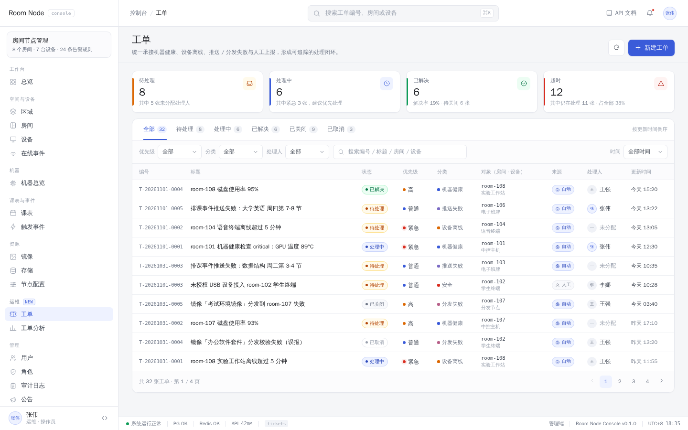

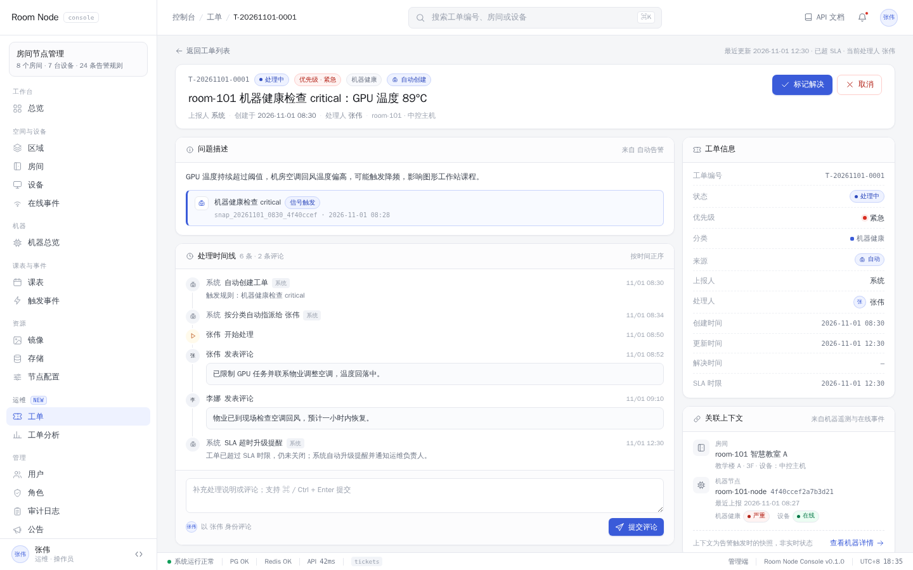

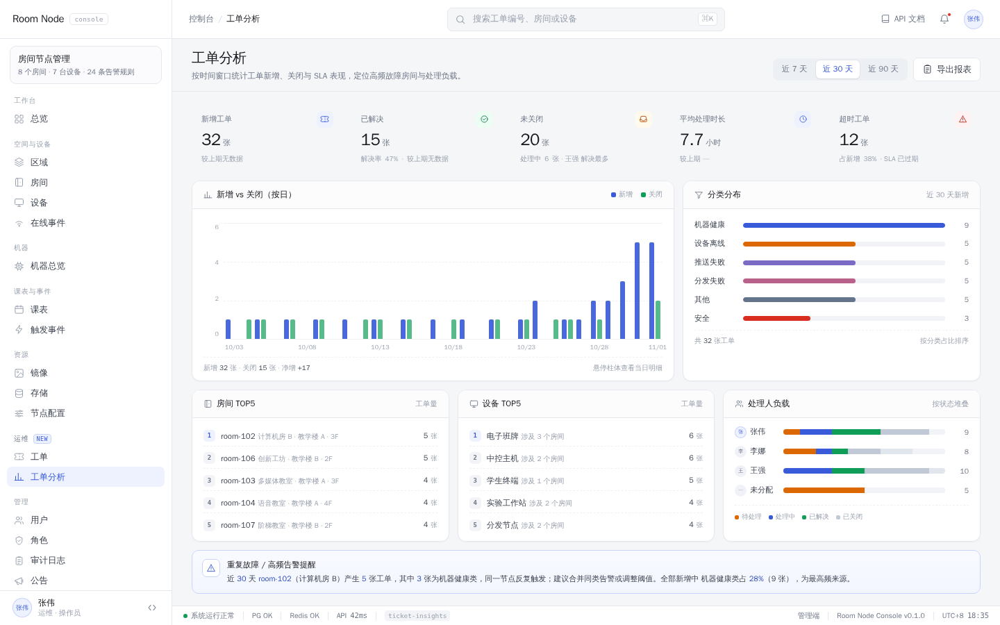

真实实现页面截图（Vue 控制台 + 新后端，1440×900，见 §10.1 验证记录）：

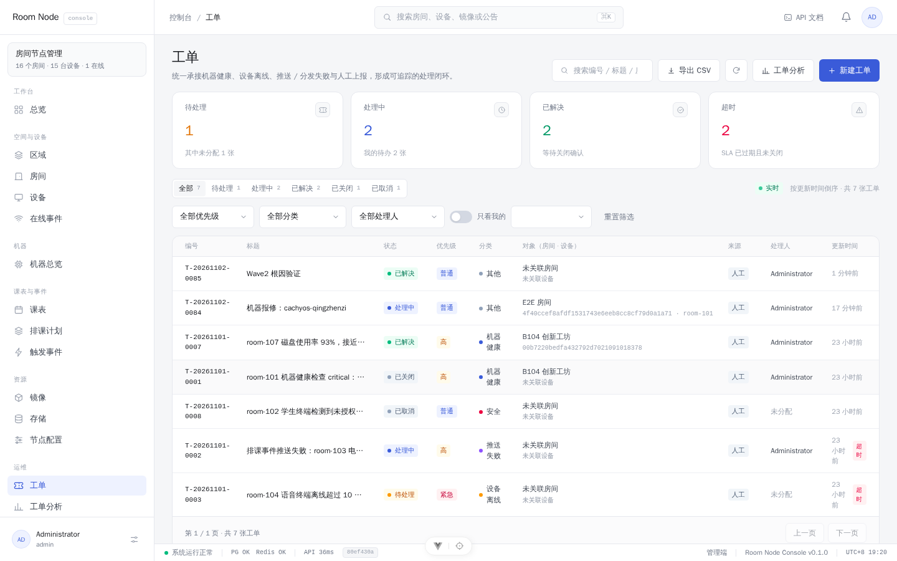

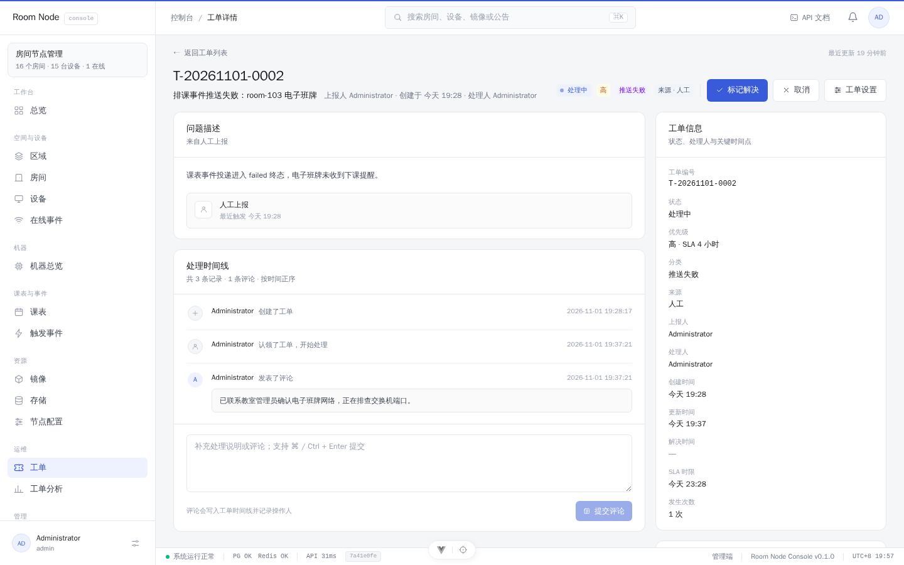

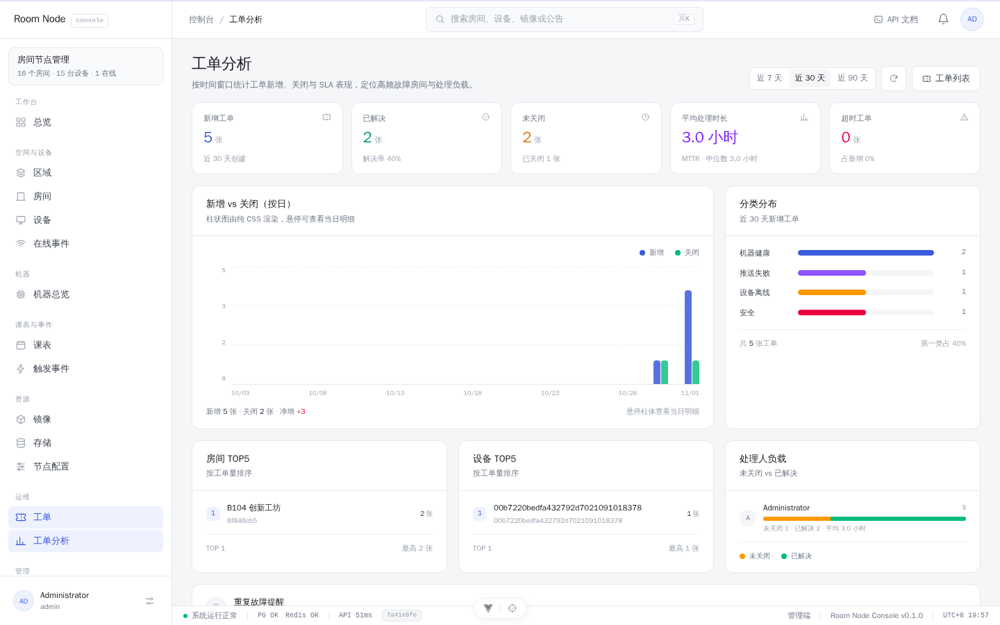

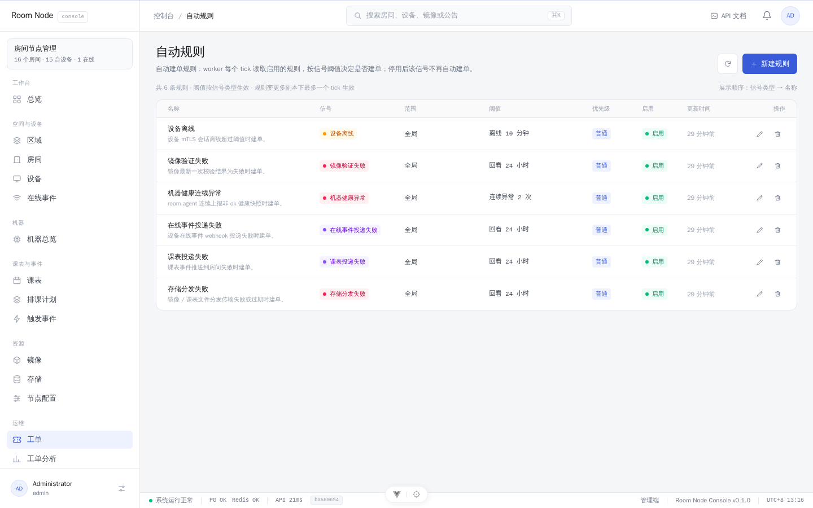

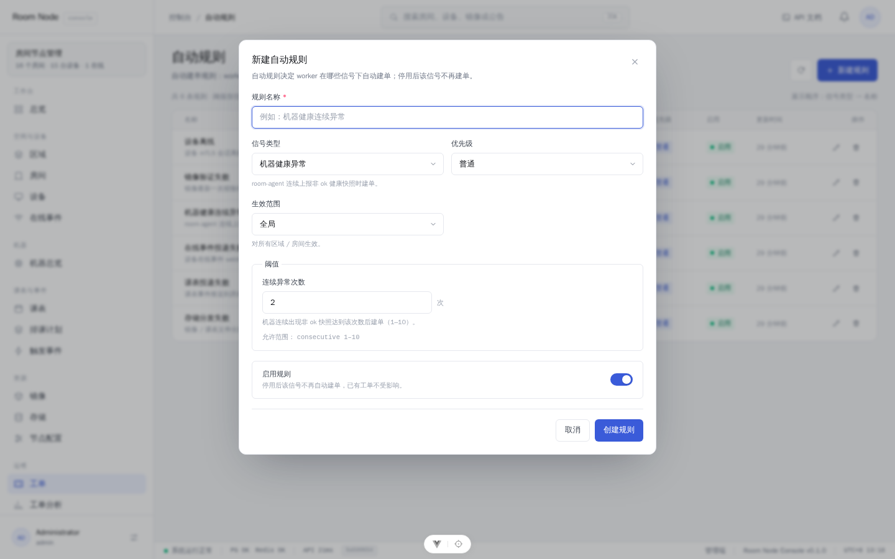

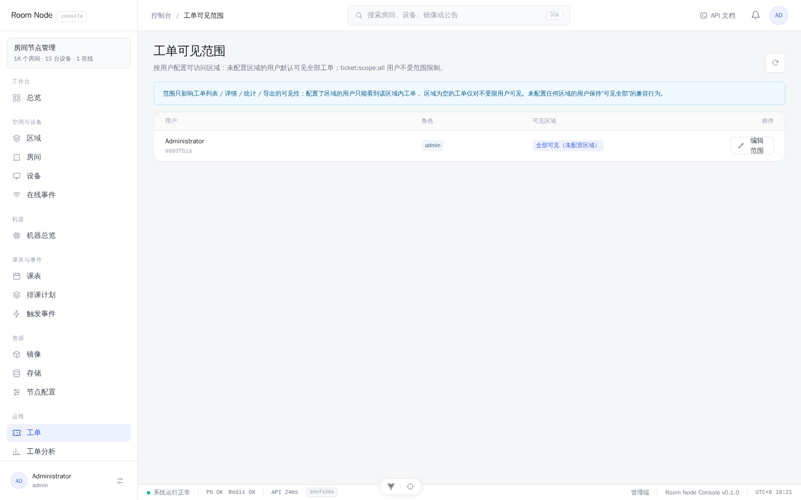

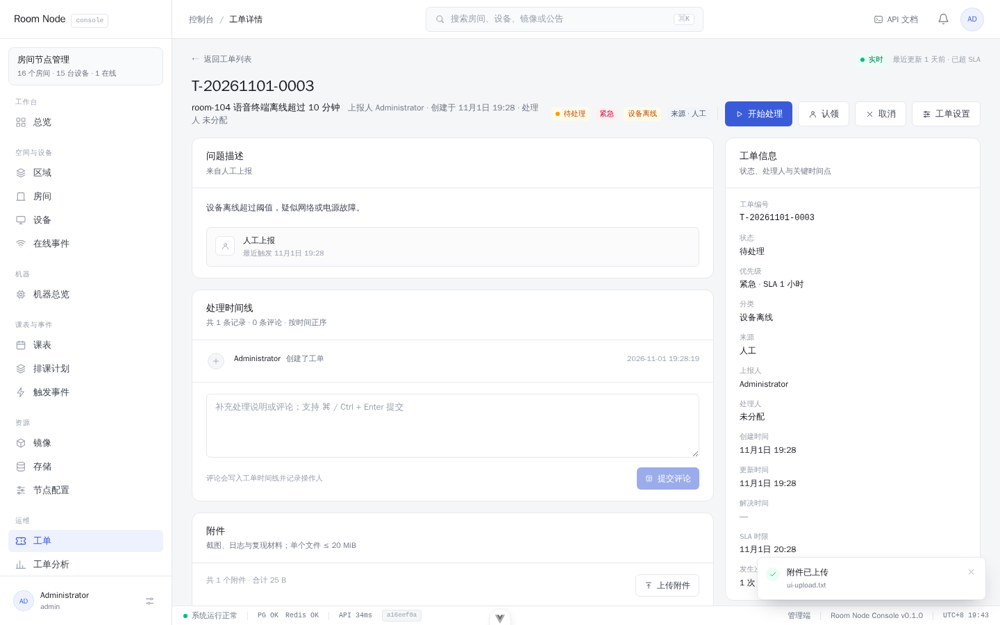

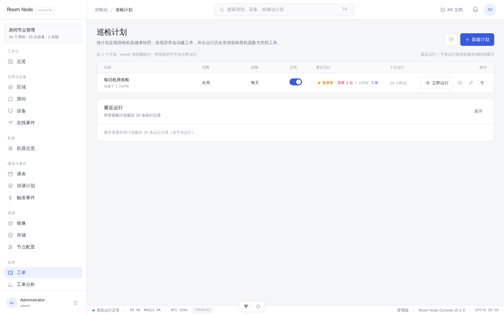

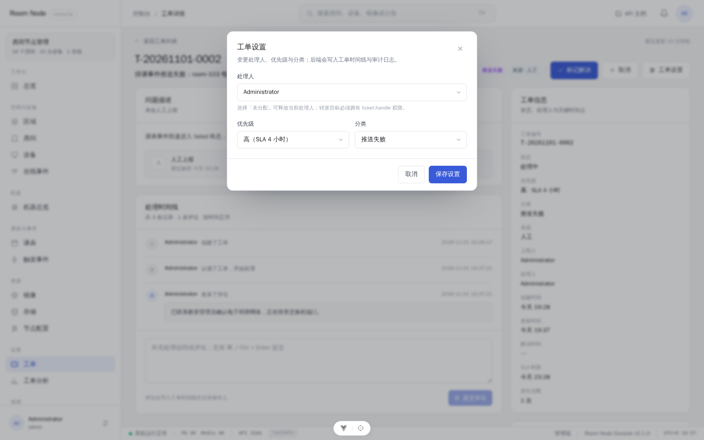

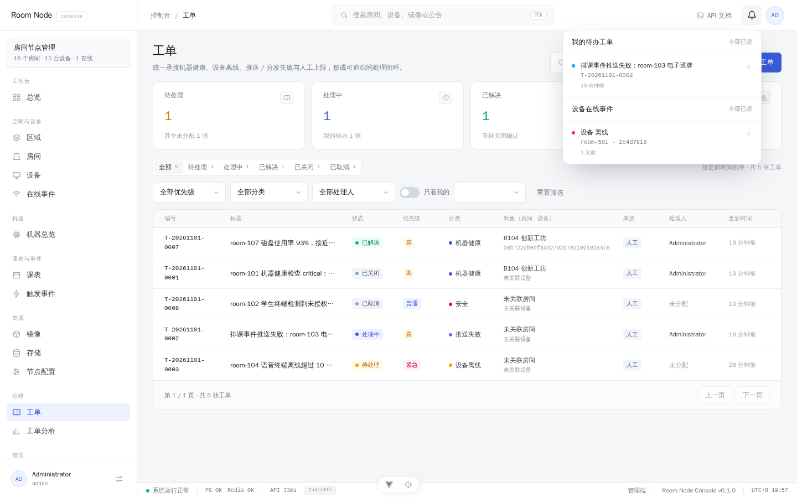

---

## 8. 通知与实时

**P0：顶栏通知中心加「我的待办工单」分组**

- 现状：通知中心只展示设备在线事件（`frontend/src/components/layout/NotificationsMenu.vue`），已读状态存在 `localStorage['rn:presence:seen-id']`（`frontend/src/stores/shell.ts:8-25`）。
- 建议：**新增独立 store**（如 `stores/ticketTodo.ts`）+ 独立已读键（`rn:tickets:seen-at`），不把工单塞进 `shell.ts` 的 presence 逻辑——两条通知生命周期不同，混在一起回滚风险大。
- 数据源：`GET /admin/tickets/summary`，60s 轮询一次（打开菜单时立即刷新），无 `ticket:read` 时不请求、不显示分组。徽标 = 在线事件未读 + 我的待办未读，保留 `9+` 截断。
- 点击待办 → 标记已读 → 跳 `/tickets/:id`（用 UUID，不用 code）。
- 不要复用 30s 的壳层轮询，避免把每次壳层刷新拖慢。

**P1/P2：**

- SSE `/tickets/stream`：新单/转派/状态变化实时推送（复用 `features/machines/useMachineStream.ts` 的 fetch + ReadableStream 模式）。
- 邮件摘要：复用现有邮件模块（`crates/api/src/email.rs`）给被转派人发通知；`EMAIL_DRIVER=smtp` 时可用。
- 升级/提醒：超时未认领 → 通知值班负责人；P2 再考虑企业微信/钉钉 webhook。
- 不做的：短信、电话、复杂升级链。

---

## 9. 历史数据分析

工单是天然的时间序数据，一旦有了 `created_at / resolved_at / assignee / category / room_id / serial`，历史分析几乎是免费的。

### 9.1 统计接口 `GET /admin/tickets/stats`

```json
{
  "from": "2026-10-02T00:00:00Z",
  "to": "2026-11-01T00:00:00Z",
  "totals": {
    "created": 42, "resolved": 35, "closed": 30,
    "open_now": 7, "overdue": 2,
    "avg_resolve_secs": 12345, "median_resolve_secs": 9000
  },
  "by_day": [{ "date": "2026-10-01", "created": 3, "resolved": 2, "closed": 1 }],
  "by_category": [{ "category": "machine_health", "count": 12 }],
  "by_priority": [{ "priority": "high", "count": 8 }],
  "top_rooms": [{ "room_id": "…", "room_name": "room-101", "count": 5 }],
  "top_devices": [{ "serial": "…", "device_slot": "room-101", "count": 4 }],
  "by_assignee": [{ "assignee_id": "…", "display_name": "张伟", "active": 2, "resolved": 10,
                    "avg_resolve_secs": 10000 }]
}
```

口径（P0 固定，写进文档避免歧义）：

- **MTTR** = 区间内 `resolved_at - created_at` 的平均值，排除 `cancelled`；同时返回中位数，避免个别长单拉偏。
- **超时** = `due_at < now()` 且状态仍为 `open/in_progress`（服务端判定，前端只展示）。
- **趋势按天**：按 `areas.timezone` 的本地日期聚合（项目已有 `local_date_of` 一类工具，见 `crates/domain/src/schedule.rs`）；不要用 UTC 日期，否则跨 0 点会错一天。
- 查询走索引 + 单接口返回全部图表数据，不做 N+1；P1 数据量大再考虑物化视图/日报表。

### 9.2 分析页能回答的问题

| 问题 | 看哪个维度 | 用途 |
| --- | --- | --- |
| 最近问题变多还是变少？ | 按日新增/关闭趋势 | 判断是环境变差还是报告变多 |
| 哪类问题最多？ | 分类分布 | 优先修系统性问题（如某类推送失败） |
| 哪个房间/设备总出问题？ | 房间/设备 TOP5 | 决定换设备、改网络、加强巡检 |
| 谁处理得最快/最忙？ | 处理人负载 + 平均时长 | 排班与工作量参考 |
| 我们响应够快吗？ | 超时数 + MTTR | 定服务目标 |
| 修完之后有没有复发？ | 同一 `dedupe_key` 的 `occurrence_count` | 识别“假修复”与重复故障 |

### 9.3 历史数据不会丢

- 工单时间线不可变；建单时把源信号快照写进 `metadata`（例如 `health.issues[]`、投递错误、事件 payload）。
- 这很重要：`machine_snapshots` 每台只保留最近 100 条，源数据会被裁剪；**工单里的快照是永久证据**。
- 原始数据仍可在工单详情的「关联上下文」跳转到机器历史快照、在线事件历史。

P1 再加：周报/月报导出（CSV）、按区域对比、根因分类（关单必填根因）、工单量与设备更换记录的关联分析。

---

## 10. 分阶段落地

### 10.1 P0：最小可用闭环（建议先做这个）

**范围**

- 迁移 `0018_tickets.sql`：`tickets` + `ticket_events` + 权限/角色播种。
- 后端：`crates/domain/src/ticket.rs`（模型/状态机）、`crates/db/src/tickets.rs`（repo）、`crates/api/src/api/admin/tickets.rs`（11 个接口）、`crates/api/src/ticket_worker.rs`（3 条自动规则）、`openapi.rs` 补 spec、`tests/tickets.rs` 集成测试。
- 前端：权限常量、3 条路由、侧边栏「运维」分组、`views/TicketsView.vue`、`views/TicketDetailView.vue`、`views/TicketInsightsView.vue`、`features/tickets/*`、`api/index.ts` 方法组、通知中心「我的待办」分组、vitest + e2e。
- 文档：README 增补、`frontend/docs/CONVENTIONS.md` 页面归属表补一行。

**P0 验收标准**

1. 没有 `ticket:read` 的账号看不到侧边栏入口，直接访问 `/tickets` 落 `/forbidden`；接口返回 403。
2. `operator` 角色能看列表/详情、认领、评论、开始/解决/关闭；不能转派给别人；`admin` 能转派、改优先级。
3. 自动规则能建单：机器连续 2 条非 ok、设备离线超 10 分钟、课表投递进入 failed 终态；同一问题只一张未结束单，重复发生 `occurrence_count` 增加。
4. 认领后状态变 `in_progress`；解决必须填说明；关闭/重开/取消都写时间线；关闭后再发生会开新单。
5. 通知中心出现「我的待办工单」角标，点击能直达详情；无权限不请求。
6. 分析页能按 7/30/90 天展示 KPI、趋势、分类/房间/设备/处理人分布，数字与列表一致。
7. 单元/集成/Playwright 测试通过；`openapi.rs` 测试断言新路径存在；前端 `vue-tsc --noEmit` 通过。
8. 重启/多副本下不重复建单（部分唯一索引 + `ON CONFLICT` 验证）。

**工作量估算**

| 部分 | 人天 | 说明 |
| --- | --- | --- |
| 后端（迁移/模型/repo/接口/worker/测试） | 8–10 | 状态机、去重、3 条规则是主要工作量 |
| 前端（权限/路由/导航/列表/详情/分析/通知/测试） | 8–9 | 见前端盘点 §5.12 |
| 联调、回归、文档 | 2–3 | 含 OpenAPI/前端类型再生成 |
| **合计** | **约 3 周** | 1 后端 + 1 前端并行 |

**落地状态（2026-11-01，P0 已完成）**

| 层 | 实际实现 | 验证 |
| --- | --- | --- |
| 迁移 | `migrations/0018_tickets.sql`（tickets / ticket_events / 4 权限 / operator 角色） | 已应用到开发库与 `qestudio_test` |
| 后端 | `crates/domain/src/ticket.rs`、`crates/db/src/tickets.rs`、`crates/api/src/api/admin/tickets.rs`、`crates/api/src/ticket_worker.rs`、`openapi.rs`（含 QA 修复迁移 `0019_ticket_event_updated.sql`） | `cargo check` / `cargo test -p qe-domain` 87 / `cargo test -p qe-db` 20 / `cargo test -p qe-api --lib` 61 / 真库集成测试 3 |
| 前端 | 3 个 View + `features/tickets/*`（13 个组件/工具，含「工单设置」弹窗）+ `ticketTodo` store + 通知中心 + 路由/导航/权限/图标 | `vue-tsc --build` 0 错误 / `vitest` 92 通过 / `vite build` 通过 / `oxlint` 0 警告 |
| 端到端 | `frontend/e2e/tickets.spec.ts`（新建→评论→认领→解决→关闭→列表检索；分析页；URL 同步） | Playwright 3/3 通过（后端 8081 + Vite 5175） |
| 契约导出 | `crates/api/examples/dump_openapi.rs` → `frontend/docs/openapi.json` → `schema.ts` | 79 paths / 20 个 Ticket* schema，前端类型再生成通过 |

真实页面截图见 §7.4，独立 QA 报告见 `docs/design/_tickets-qa-report.md`。

### 10.2 P1：把“能用”变“好用”（Wave 1 已完成，2026-11-02）

> Wave 1 已落地：独立细粒度 RBAC（+`ticket_operator` 角色）、规则配置化、3 个新信号源、SLA 超时提醒+邮件、工单 SSE、CSV 导出。契约与验证见 `docs/design/ticket-p1-contract.md`。

- ✅ 自动规则配置化：`ticket_rules` 表 + `/tickets/rules` 管理页（阈值/优先级/范围/启停）。
- ✅ 多信号源：在线投递失败、存储分发失败、镜像验证失败（节点配置下发/安全事件仍需先补持久化信号，后续）。
- ✅ 升级与 SLA：按优先级默认时效；超时提醒（`reminded` 事件 + 邮件 + `last_reminded_at` 水位）。
- ✅ 通知增强：工单 SSE 实时流；邮件通知（转派/超时；无 SMTP 时 log driver）。
- ✅ 数据范围：按用户授权区域限制可见/可处理（`ticket_scopes` + `ticket:scope:all`；无授权 = 不限制）。
- ✅ 附件：对象存储预签名上传/下载（≤20MiB，`ticket:attachment`）。
- ✅ 分析增强：CSV 导出。
- ✅ 根因分类（resolve/close 可选 6 类）；周报仍待做。
- ✅ 房间/设备/机器详情页「报修/建单」入口（预填 room/serial/device_slot）。

### 10.3 P2：预测与值班（按需）

- 巡检计划（定时巡检 → 巡检报告 → 异常升级工单）、按课表时段抑制误报。
- 值班排班/值班大屏（此时才可能需要独立 layout）。
- 知识库/相似工单推荐；关闭时推荐历史解法。
- 工单与设备更换、网络改造记录的关联；故障预测（基于 `machine_snapshots` 历史与工单频次）。
- 自动关闭（仅在“信号恢复 + 人工确认”组合下，默认不开启）。

### 10.4 建议的实施顺序

1. 迁移 + 权限 + 手工建单/列表/详情（能录入、能看）。
2. 状态机 + 认领 + 评论 + 时间线（能处理）。
3. 自动建单 worker（机器健康 → 离线 → 投递失败，逐条灰度开启）。
4. 通知中心 + 分析页（能发现、能复盘）。
5. 再按 P1 加规则配置与更多信号源。

---

## 11. 风险与边界

| 风险 | 影响 | 对策 |
| --- | --- | --- |
| **告警噪音** | 工单被淹没，没人看 | 连续 N 次才建单、单 `dedupe_key` 聚合、`occurrence_count`、按房间+目标+日期合并；P0 默认时间窗近 7 天 |
| **教室正常关机误报** | 离线工单泛滥 | P0 阈值 10 分钟 + 开关可关；P1 按课表时段/预期在线判定；先观察两周再开 |
| **多副本重复建单** | 同一问题多张单 | DB 部分唯一索引 + `ON CONFLICT DO NOTHING`，Redis 锁只降负载（见 §4.4） |
| **自动关单掩盖根因** | 问题“看起来解决了” | P0 不自动关单；信号恢复只追加时间线提示 |
| **时区/日期聚合错位** | 统计差一天 | 按 `areas.timezone` 本地日期聚合 |
| **权限缓存 5 分钟** | 上线后旧会话仍 403 | 发布说明提醒重登；或重启副本触发权限代际刷新 |
| **快照被裁剪** | 历史证据丢失 | 建单时把信号快照写入 `metadata` |
| **工单变“只写不读”** | 处理人不看，工单烂尾 | 通知角标 + 超时提醒（P1）+ 分析页固定入口 |
| **范围膨胀** | 做成 ITSM，拖半年 | 坚守 §2.2 非目标；P0 三张页面、不做审批/值班/知识库 |
| **XSS/敏感信息** | 评论/描述注入 | 纯文本展示，禁止 `v-html`；不把 token/密码写进工单描述 |

---

## 12. 需要你确认的决策

以下是会显著影响实现的几个点，括号里是我的建议：

1. **自动离线工单默认开还是关？**（建议：默认开，阈值 10 分钟，并在管理页留开关；观察两周误报后再决定是否加“仅上课时段”判定。）
2. **P0 是否包含通知中心「我的待办」？**（建议：包含。没有提醒的工单很容易烂尾，但它会改一个受限的 layout 组件，需要批准。）
3. **工单路由用 UUID 还是单号？**（建议：路由用 UUID，页面展示 `T-YYYYMMDD-####`；单号只用于搜索。）
4. **是否允许工单不绑定房间/设备？**（建议：允许。区域级网络/推送问题可能跨越多个房间，用 `area_id` + 空 `room_id` 表达。）
5. **谁维护 `operator` 角色和自动规则？**（建议：迁移先播种一个 `operator`，之后由管理员在角色页维护；规则 P1 再做成配置页，P0 用环境变量。）
6. **要不要匿名扫码报修？**（建议：P2。P0 先覆盖有账号的运维/管理员。）

---

## 13. 附录：相关文件

> 命名对齐说明：两份盘点文档写于命名统一之前，其中自动工单字段的 `kind` / `severity`（P0–P3）与本文的 `category` / `priority`（urgent–low）指同一组字段；接口写法也以本文 §6 为准（`summary` / `claim` / `assign` / `transition` 分开，`PATCH` 只改内容）。落地时统一用 `category` / `priority`。

- 后端现状盘点（信号源/worker 范式/RBAC/迁移/DDL 草案）：`docs/design/_tickets-backend-inventory.md`
- 前端现状盘点（壳层接线/页面模式/API 层/通知/文件拆分/测试）：`docs/design/_tickets-frontend-inventory.md`
- 实现契约（已落地，字段/接口/文件归属以此为准）：`docs/design/ticket-implementation-contract.md`
- 独立 QA 报告：`docs/design/_tickets-qa-report.md`
- 可交互原型：`prototype/tickets/index.html`（说明见 `prototype/tickets/README.md`）
- 已实现代码入口：
  - 迁移：`migrations/0018_tickets.sql`
  - 领域/仓储：`crates/domain/src/ticket.rs`、`crates/db/src/tickets.rs`
  - HTTP/worker：`crates/api/src/api/admin/tickets.rs`、`crates/api/src/ticket_worker.rs`
  - OpenAPI/导出：`crates/api/src/api/openapi.rs`、`crates/api/examples/dump_openapi.rs`
  - 前端页面：`frontend/src/views/TicketsView.vue`、`TicketDetailView.vue`、`TicketInsightsView.vue`
  - 前端组件/工具：`frontend/src/features/tickets/`、`frontend/src/stores/ticketTodo.ts`
  - 端到端测试：`frontend/e2e/tickets.spec.ts`
- 现有信号关键位置：
  - 机器遥测：`docs/machine-telemetry.md`、`migrations/0014_machine_telemetry.sql`、`crates/api/src/api/admin/machines.rs`
  - 设备在线事件：`migrations/0013_device_presence.sql`、`crates/api/src/presence.rs`、`crates/api/src/api/admin/device_events.rs`
  - 课表事件投递：`migrations/0009_schedule.sql`、`crates/api/src/scheduler.rs`、`crates/api/src/api/admin/schedule_events.rs`
  - 存储/镜像：`migrations/0011_storage.sql`、`crates/api/src/api/admin/storage.rs`、`crates/api/src/api/admin/images.rs`
  - 审计：`migrations/0003_audit.sql`、`crates/api/src/api/admin/audit.rs`
  - 权限：`crates/domain/src/rbac.rs`、`crates/auth/src/permission.rs`、`crates/api/src/bootstrap.rs`
- 前端约定：`frontend/docs/CONVENTIONS.md`、`frontend/docs/api-contract.md`
- 既有同类设计文档（风格参考）：`docs/design/schedule-board-implementation-contract.md`
