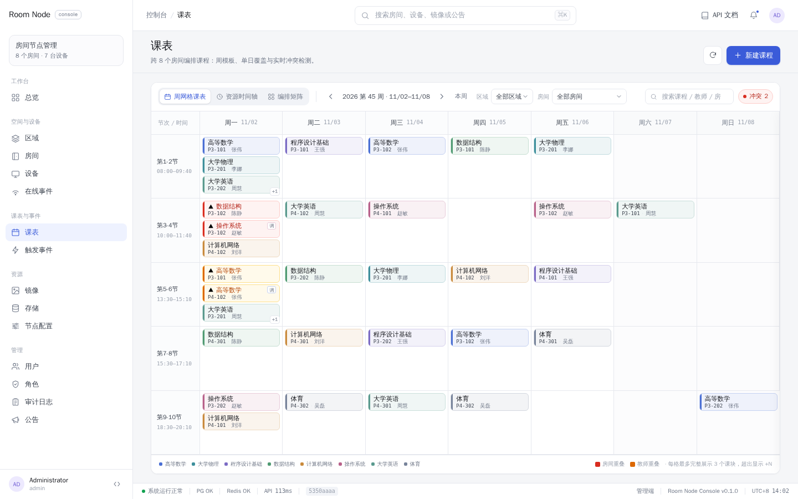
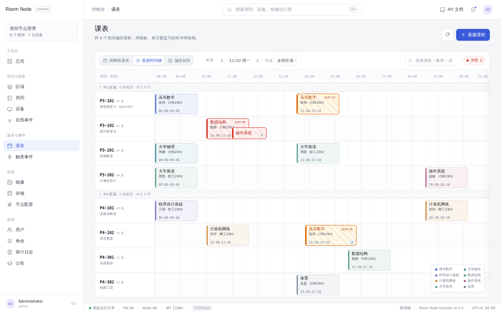
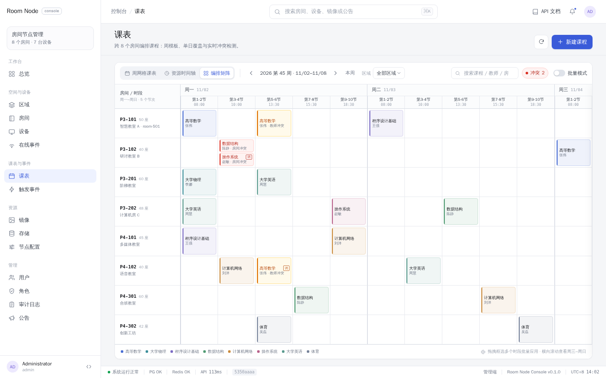

# 课表重设计提案：跨房间可视化排课（排课工作台）

> 状态：**v1 已实现**（2026-11-01）。本文定产品形态与实施路径；实现契约见
> [`docs/design/schedule-board-implementation-contract.md`](design/schedule-board-implementation-contract.md)。
> v1 落地范围：后端 `GET /admin/schedule-board` + `POST /admin/schedules/ensure`（薄聚合，未改表结构）；
> 前端 `/schedules` 排课工作台（A/B/C 三视图、新建/编辑/删除、拖拽改课、冲突提示、真实保存链路），
> 单日调课（v1.5）、撤销/重做（v1.6）、C 矩阵框选批量（v1.7）与框选复制/粘贴（v1.8）已补齐；
> 全局排课实体（路径 2）留待下一阶段。
>
> 输入材料：
> - 后端能力盘点与两条演进路径：`docs/design/schedule-board-backend-notes.md`
> - 前端现状、三方案交互规格与组件树：`docs/design/schedule-board-frontend-notes.md`
> - 可离线打开的原型：`prototype/schedule-board/index.html`（`#week` / `#timeline` / `#matrix`）
> - 三张 1440×900 设计稿：`docs/design/prototype-week.png`、`prototype-timeline.png`、`prototype-matrix.png`

## 0. 一句话结论

**把「课表」从「房间的一个属性」升级为「面向整栋楼的排课工作台」**：一个页面里同时看到/编辑所有房间，
提供三套共享数据的视图（A 周网格课表 = 日常看与改、B 资源时间轴 = 单日调课与冲突处理、C 全房间编排矩阵 = 开学批量铺课），
右侧是课程检查器与冲突提示。

数据侧分两步：**先做「薄聚合」只读接口（不动表结构，约 1 周出可点的真实数据工作台）**，
形态确认后再把写模型迁移到「学期 + 课程/教师/班级 + 排课条目」的全局实体（约 26 人日，可分阶段灰度）。

## 1. 为什么现在的课表会「很奇怪」

现状链路（`docs/schedule-design.md`）：

```
区域(area) → 房间(room) → 课表(schedule, room-scoped) → 周模板(weekly_slots) / 单日覆盖(exceptions)
                                   → 物化实例(occurrences) → 触发规则(event_rules) → 事件/投递
```

问题不在 UI 少一个页面，而是**抽象错位**：课表的数据归属是「房间」，而排课这件事的工作对象是「整栋楼」。
于是所有跨房间操作都变成绕路：

| 现象 | 根因 |
| --- | --- |
| 没有「所有房间」视图，只能一个房间一份课表地翻 | `schedules.room_id` 是 owner；`/schedules` 只按单房间过滤，且不返回模板 |
| 调一节课到别的房间，要改两份课表，改完两边都看不全 | 实例迁到目标房间，但模板仍属源课表（`room_override` 是「半边」语义） |
| 看不见冲突（同房间撞课、同教师撞课） | 后端只有「同课表同天时段不重叠」校验，没有跨课表/教师维度 |
| 「只改这一周」很难：单日覆盖是整天替换/整天停课，不能只动一节 | `schedule_exceptions` 一天一条、`replace` 替换整天全部时段 |
| 保存模板后课块 ID 全变，事件引用会断 | 周模板保存是 DELETE+INSERT 全量替换；事件键依赖 `occurrence_id` |
| 冲突/重复提醒风险 | 重建实例会删掉未来实例 → 当前开发库（本机运行中）4 条历史事件的 `occurrence_id/schedule_id` 已全部为 NULL（payload 仍留旧 UUID） |

结论：**「编排」需要成为一等公民**。保留「房间 / 实例 / 事件 / 投递」作为执行层（这层是对的，设备联动也靠它），
在它之上加一个以「整栋楼」为视角的排课工作台与（目标态的）全局排课模型。

## 2. 目标场景（先对齐要解决的问题）

| 编号 | 场景 | 频次 | 主要视图 |
| --- | --- | --- | --- |
| S1 | 学期初/换季，把 8 个房间 × 一周 × 若干节次一次铺满 | 每学期 1~2 次 | C 编排矩阵（框选/批量/复制） |
| S2 | 日常调课：某节课换房间、改时间、停课、找空房 | 每周 | B 资源时间轴（拖拽）+ A 交叉查看 |
| S3 | 查看与执行：今天/本周各房间怎么排；上课前后设备动作是否触发 | 每天 | A 周网格 + 现有触发事件页 |
| S4 | 冲突治理：发现并消除同房间/同教师撞课 | 每次编排 | 三视图顶部冲突计数 + 定位 |

**本期不做**：学生端/教师端门户、调课审批流、跨校区/多节点同步、教室容量智能分配、排课算法自动生成。
（这些都能在全局模型就绪后作为独立迭代追加。）

## 3. 三套可视化形态

三套视图共享同一份数据、筛选、日期上下文、草稿与冲突引擎；切换视图不丢状态。
原型截图（1440×900，完整控制台外壳，可离线交互）：

### A · 周网格课表（列 = 周一~周日，行 = 节次）



- 像教务系统的「总课表」：整周一眼看完，不需要横向滚动；每格列出该时段的课块（课程名 + 房间码 + 教师）。
- 全部房间聚合时格内最多 3 块、超出显示 `+N`；按区域/房间筛选后信息完整。
- 适合 S3 日常查看、单块编辑；点击课块 → 右侧检查器，改房间/星期/时间。
- 局限：跨房间拖拽不直观（8 房间同时铺满时格子会密），大改适合去 C。

### B · 资源时间轴（行 = 房间按区域分组，X = 时间，单日）



- 像 Outlook/会议室排班：8 个房间一屏放下，横向 08:00–21:00 完整，课块长度=真实时长。
- 拖拽课块可跨房间/跨时间移动并吸附，边缘拉伸改时长（目标态）；冲突块立即红色高亮，
  同房间重叠/同教师冲突用不同徽标区分。
- 适合 S2 调课与 S4 冲突处理；点击课块 → 右侧检查器（含「单日覆盖 / 取消本次」入口）。
- 局限：一次只呈现一天；「只改这一天」的落库语义必须先定（见 §5 决策点 3）。

### C · 全房间编排矩阵（行 = 房间，列 = 周一~周日 × 节次）



- 像 Excel 排课表：行=房间、列=一周的节次，空格点击新建、鼠标框选多个格子批量应用课程。
- 最适合 S1 开学批量铺课与「把整周在矩阵里改一遍」；行头显示房间容量/设备槽位。
- 局限：必须横向滚动（1440 宽约看到 1.5 天），需要星期快捷定位 + 粘性房间列；手势要与拖拽区分（空格起框选）。

### 三方案对比

| 维度 | A 周网格 | B 资源时间轴 | C 编排矩阵 |
| --- | --- | --- | --- |
| 心智模型 | 教务系统总课表 | 会议室排班 | Excel 排课表 |
| 时间维度 | 模板周（weekday） | 具体日期 | 模板周（weekday） |
| 一屏看到 | 整周、全部房间聚合 | 一天、全部房间 | 一周、全部房间（需横滚） |
| 最适合 | 日常看、单块改 | 调课、冲突处理、改时长 | 批量铺课、整周大改 |
| 拖拽跨房间 | 通过检查器改房间 | 原生支持 | 支持（拖到另一行） |
| 框选批量 | 无 | 无 | 核心能力 |
| 横向滚动 | 无 | 无 | 必须 |
| 实现成本（前端） | ~3.5 人日 | ~3 人日 | ~2.5 人日 |

### 推荐组合（不是三选一）

**`/schedules` 改为「排课工作台」，顶部三段切换 `周网格 | 时间轴 | 编排矩阵`。**

1. **默认 A 周网格**：打开即「整栋楼这周怎么排」，最容易被非技术同事理解；区块信息最完整。
2. **B 时间轴**：从 A 的「某天要调课」入口（或日期导航）进入，承担拖拽与冲突处理。
3. **C 编排矩阵**：从空状态/工具栏「批量铺课」进入，承担开学铺课与跨周复制。
4. 右侧统一使用**课程检查器抽屉**（课程、教师、班级、房间、日期/时间、来源=模板周/单日覆盖、触发规则摘要、设备在线状态），
   编辑动作在抽屉里完成，避免三种画布各写一套编辑表单。

> 如果只能先做一屏：做 **A**（实现最稳、最像「课表」，能立即验证「所有房间一张图」）。
> 如果你更想要「编排感」：做 **C**。B 的拖拽最爽，但依赖后端落库语义先定，建议第二批。

## 4. 推荐产品形态：排课工作台

### 4.1 信息架构

- 路由：`/schedules` → 排课工作台（保留 `name: schedules`，侧栏不变）；旧列表挪到 `/schedules/list`；
  `/schedules/:id` 保留为「单房间精细维护」（周模板/覆盖/实例/重建）。
- 工作台 URL 状态可分享/刷新恢复：`?view=week|timeline|matrix&week=2026-11-02&date=…&area=…&room=…`。
- 页面结构：

```
PageHeader    课表 · 排课工作台            [刷新] [课表列表] [+ 新建课程]
BoardToolbar  [周网格|时间轴|编排矩阵]  ‹ 今天 ›  <周导航>  [区域▾][房间▾] [只看冲突]   ⚠ 2 冲突
BoardCanvas   A/B/C 三选一（粘性表头/行头、统一空/错/加载态）
BoardSaveBar  〔N 项未保存〕[撤销][重做][放弃]                  [保存到 M 张课表]
BlockDrawer   右侧课程检查器（详情 + 编辑 + 删除 + 复制到…）
```

- 底部提示行：拖拽/框选/快捷键说明 + 本视图统计（本周课次、冲突数、未排课程、房间利用率）。

### 4.2 统一语义（必须在 UI 上明示，避免误删整学期）

- **A / C 编辑的是「模板周」**：改动影响课表整个生效区间（可由后端自动重建未来实例）；
- **B 编辑的是「具体日期」**：任何改动落为单日覆盖（停课/替换），不影响其他周；
- 表头/检查器用「模板」「本周覆盖」「单日停课」徽标区分来源；删除/替换类操作二次确认。

### 4.3 关键交互（三视图共享）

| 交互 | 说明 |
| --- | --- |
| 点击空格 | 新建课程（预填房间/星期/节次/时间），提交后进草稿，不立即写库 |
| 点击课块 | 右侧检查器：查看/编辑/删除/复制到其他房间或时段 |
| 拖拽移动 | A：吸附节次；B：吸附 15 分钟、可跨房间行；C：吸附格子 |
| 边缘拉伸 | 仅 B（改时长）；A/C 用节次离散时间 |
| 框选批量 | 仅 C：矩形选框 → `BatchFillModal`（选课程/教师/重复周次、覆盖确认） |
| 复制/粘贴 | C 矩形区域复制；A 支持「复制整个房间的一周到另一房间」 |
| 撤销/重做 | 前端草稿层 50 步；保存后清空（全局模型就绪后可做服务端版本） |
| 冲突即时预览 | 拖动时计算落点冲突：房间重叠=阻止（红）、教师同名冲突=警告（黄）、超有效期=阻止 |
| 只读降级 | 无 `schedule:manage` 时隐藏所有写入口，仅可查看与复制 |
| 状态 | 加载骨架、空态（无房间/无课表/筛选无结果）、错误条+重试、未保存离开确认 |

### 4.4 视觉与性能约束

- 沿用现有控制台设计 token（`frontend/src/assets/main.css`）与组件（`AppModal/FormField/Toast/ConfirmDialog/FilterTabs/PaginationBar/EmptyState`），
  画布网格线用更低对比度（`line/40`）；颜色按「课程」稳定 hash 分配低饱和色板，冲突用红色描边/斜纹。
- 规模：8 房间 × 7 天 × 5~6 节 ≈ 300 课块，三视图均可用普通 DOM + `v-memo`，不需要虚拟滚动；
  数据量按「周」拉取，切换周重新请求，区域/房间筛选在内存中过滤。
- 现有接口下前端需 1+N 次请求（8 房间 ≈ 19 个 GET），用并发池 + 逐行骨架兜住；
  **P1 后端补聚合接口后收敛为 1~3 次请求**。

## 5. 数据模型：两条演进路径

### 路径 1 · 薄聚合（先做只读，不改表）

在现有 room-scoped 模型上新增读模型与批量写接口，让工作台先跑起来：

| 接口（`/api/v1/admin`） | 权限 | 作用 |
| --- | --- | --- |
| `GET /schedule-board?from&to&area_id` | schedule:read | 一次返回 areas→rooms + occurrences（含 room/area/schedule 名称、本地时间）+ 模板摘要 |
| `GET /schedules/templates?area_id&from&to` | schedule:read | 全量 schedule + weekly_slots + exceptions（替代 1+N） |
| `GET /schedule-conflicts?from&to&area_id` | schedule:read | 内存展开（复用 `expand_occurrences`，不落库）→ 房间/教师/重复课表冲突清单 |
| `POST /schedules/ensure` | schedule:manage | 幂等为「没有课表的房间」补默认课表 |
| `PUT /schedules/weekly-slots/batch` | schedule:manage | 跨房间批量写模板（单事务 + 逐课表重建） |
| `PUT /schedules/exceptions/batch` | schedule:manage | 跨房间单日停课/替换 |
| `POST /schedule-conflicts/preview` | schedule:manage | 拖拽未保存时预检落点 |

- 工时 ≈ **8 人日**（domain 0.5 / db 2 / api 1.5 / 前端配合 3 / 测试 1），**0 表迁移、0 数据迁移**。
- 能交付：三视图「能看、能改」、单日停课/替换、模板级批量、冲突检测。
- 做不到（语义债，不建议长期打补丁）：撤销、拖拽改时长、跨周批量、稳定条目 ID、教师冲突硬拦截、
  「调课」仍会给源/目标两个房间留下不对称状态。

### 路径 2 · 全局排课实体（目标态，分阶段+可灰度）

新增：`terms`（学期）+ `courses` / `teachers` / `classes`（轻量主数据）+ `schedule_plans`（草稿/发布版本）
+ `plan_entries`（day_of_week + 起止时间 + 课程 + **room_id 可改** + 有效期）+ `plan_adjustments`（条目级单日调整）；
发布时才物化 occurrences，并按 `(plan_entry_id, date)` **UPSERT**（而不是删了重插）→ 条目 ID 稳定、事件键稳定。

- 工时 ≈ **26.5 人日**（domain 4 / db 7.5 / api 5 / 前端 6.5 / 测试 3.5），拆三阶段：
  P1 主数据 + 迁移（8.5）、P2 计划/条目/物化 + 事件键（10.5）、P3 发布/回滚/单日调整/审计（7.5）。
- 解锁：拖拽即改 `room_id`；一次提交一个事务；撤销=revision；教师/班级冲突硬拦；学期/发布/回滚；
  事件键稳定（顺手修掉当前开发库中 `occurrence_id` 全 NULL 的隐患）。
- 迁移窗口很好：当前开发库的课表数据几乎为空（1 份课表、0 模板、0 实例、0 规则、4 条历史事件），
  纯新增表 + 兼容列 + 回填脚本即可，`materialize` 开关可回退。

### 推荐

**先路径 1 的只读部分，确认产品形态；写模型按路径 2 分期落地，不要长期停在路径 1 的批量补丁上。**

理由：用户要的是「编排所有房间」，路径 1 下每次跨房间操作都是 N 份课表 + N 次重建 + 无原子性，
界面做得越像 B/C，后端口径越别扭；而当前开发库的数据量正是迁移成本最低的窗口。路径 1 的读接口 JSON 结构
在路径 2 里可以原样保留，前端不会白做。

## 6. 实施路线

| 阶段 | 交付 | 依赖 | 粗估 |
| --- | --- | --- | --- |
| **P0（本次）** | 三方案原型 + 设计提案 + 决策 | 无 | 已完成 |
| **P1 只读工作台** | 聚合接口 `schedule-board` / `conflicts`；`/schedules` 工作台壳 + A 只读 + 冲突计数 + 筛选/URL 状态 + 旧列表迁移 | 路径 1 读接口 | 后端 3~4d + 前端 3d |
| **P2 编辑闭环（A）** | 检查器抽屉、新建/编辑/删除、A 内拖拽改星期/节次/房间、草稿/脏标记/撤销/重做、保存条、只读降级 | P1 | 前端 4d + 联调 1d |
| **P3 时间轴（B）** | 单日视图、拖拽跨房间/吸附、单日覆盖（停课/替换）、冲突实时预览、horizon 提示 | 跨房间落库语义（决策点 3） | 前端 3~4d + 后端 2d |
| **P4 批量（C）** | 矩阵视图、框选、批量填充、矩形复制粘贴、横向滚动性能 | 批量写接口 | 前端 2.5d + 后端 2d |
| **P5 全局模型** | 0018 迁移 + 主数据 + 计划/条目/发布 + 事件键稳定 + 回填 + 灰度 | 用户确认长期方向 | 26.5d（可分 3 期） |

**关键节点**：P1 完成后给用户实机走查，确认「A 默认 / 三视图组合」是否符合预期，再决定是否继续 P3/P4
还是直接进 P5（推荐：P2 完成后即可启动 P5 的 P1 期，二者可并行）。

## 7. 验收标准（P1+P2 首版）

1. 打开 `/schedules` 一次请求内渲染 8 房间/2 区域整周课表，无横向滚动溢出；1440×900 与 1280×800 均可用。
2. 全部房间聚合时格内课块最多 3 个 + `+N`；区域/房间/搜索/只看冲突筛选 300ms 内生效，切换视图不丢状态。
3. 冲突：同房间重叠、同教师同名重叠、超课表有效期、无课表房间四类均可被 `schedule-conflicts` 检出并在 UI 定位。
4. 编辑：新建/移动/删除 → 保存后刷新结果一致；保存失败能定位具体课块并保留草稿；撤销/重做 50 步不崩。
5. 只读账号隐藏所有写入口，直接访问 URL 也不触发写请求。
6. 单房间详情页（`/schedules/:id`）与触发事件页行为不变；事件投递链路无回归。
7. `cargo test --workspace`、`vue-tsc --noEmit`、lint 通过；新增写接口有审计与权限校验。

## 8. 待拍板问题（每条给默认建议）

| # | 问题 | 默认建议 |
| --- | --- | --- |
| 1 | 三视图都要，还是先做一个？默认打开哪个？ | 三视图同批设计、分阶段上线；**默认 A 周网格**（最易懂） |
| 2 | A/C 的「周」是模板周还是本周？ | **模板周**（改一次影响整个生效区间），UI 明示；「只改本周」走 B 的单日覆盖 |
| 3 | B 跨房间拖拽怎么落库？ | 目标态=直接改条目 `room_id`；若先走路径 1，**暂只做同房间移动/改时间**，跨房间等 P5 |
| 4 | 数据模型：先薄聚合，还是直接全局重构？ | **先薄聚合只读（P1，约 1 周可看）→ 再分阶段全局重构（P5）** |
| 5 | 课程/教师/班级是否建实体？ | **建**（路径 2 的轻量主数据；条目存名称快照避免改名破坏历史） |
| 6 | 冲突策略？ | 房间重叠=阻止；教师同名=警告；超有效期=阻止；草稿阶段只提示不拦截，发布/保存时硬拦 |
| 7 | 旧页面与接口保留多久？ | 旧列表页保留为 `/schedules/list` 一个版本；旧写接口保留只读兼容，写入口收敛到工作台 |

## 9. 落地状态（v1.6，2026-11-01）

| 能力 | 状态 | 说明 |
| --- | --- | --- |
| 后端 `GET /admin/schedule-board` | ✅ 已实现 | 6 条批量查询无 N+1；返回区域/房间（含设备在线）/课表/周模板/单日覆盖 |
| 后端 `POST /admin/schedules/ensure` | ✅ 已实现 | 幂等补默认课表；审计 `schedule.ensure` |
| `/schedules` 排课工作台 | ✅ 已实现 | 旧列表迁 `/schedules/list`；单房间详情保留 |
| A 周网格（全部房间聚合、点击新建/编辑、拖拽改星期/节次、`+N` 折叠） | ✅ 已实现 | 默认视图 |
| B 资源时间轴（单日、按区域分组、拖拽跨房间/改时间） | ✅ 已实现 | 行高固定、冲突错位堆叠 |
| C 编排矩阵（房间 × 周 × 节次、点空格新建、拖拽换房间/跨天/跨节次） | ✅ 已实现 | 横向滚动 + 粘性表头/房间列 |
| 冲突检测与展示（房间重叠/教师跨房间） | ✅ 已实现 | 前端按周展开计算，红色/琥珀样式 + 计数 chip |
| 右侧课程检查器 + 新建/编辑弹窗 + 删除二次确认 + 只读降级 | ✅ 已实现 | 编辑即时保存（ensure → replace → rebuild → 刷新） |
| 单日调课/停课（写单日覆盖） | ✅ 已实现（v1.5） | B 视图默认「本次」作用域；拖拽/新建/本次停课/恢复本次；跨房间移动写源+目标当天覆盖，恢复时两边还原；过去日期拦截 |
| 撤销/重做（模板编辑 + 单日调整，≤50 步） | ✅ 已实现（v1.6） | 前端快照历史栈；工具栏按钮 + Ctrl/Cmd+Z、Ctrl+Shift+Z / Ctrl+Y；撤销/重做后 reload |
| C 矩阵框选批量应用/清除 | ✅ 已实现（v1.7） | 拖拽框选跨房间/天/节次；批量应用（仅填空格/覆盖）预览冲突校验；批量清除；一次批量一条撤销历史 |
| C 矩阵矩形复制/粘贴 | ✅ 已实现（v1.8） | 框选/行头整行复制（仅模板块）；粘贴模式按相对矩形落库、覆盖目标同节次、越界跳过；确认预览；一次粘贴一条撤销历史 |
| 路径 2 Phase A：学期 / 课程·教师·班级主数据 / 排课计划草稿与发布 | ✅ 已实现（v2.0-alpha） | 新页面 `/schedules/plans`；发布事务桥接写 legacy 课表并重建实例；同 term 单 published；已发布可克隆；班级暂未进入 legacy 槽位/事件 payload |

已知边界：房间课表生效区间不包含当前周时，新建可落库但画布不显示（会提示去 `/schedules/list` 调整有效期）；
A/C 的节次使用固定 5 段模板（08:00–20:10），非常规时段按最近节次归档；单日覆盖的「恢复本次」以整天为单位
（同一天该课表的多节单日调整会一起恢复），跨房间两次写非事务（失败时以 `load()` 兜底，可重试）；
撤销/重做历史仅当前页面会话有效（刷新丢失），模板快照不含课表本身（`ensure` 新建的课表撤销后保留为空课表）；
C 矩阵框选只改周模板（不写/不删单日覆盖），拖拽框选不自动横向滚动，切换周/区域/视图会清空选区；
C 矩阵复制/粘贴同样只处理模板（当天有单日覆盖的源格不复制），行头整行选择为 7 天×5 节次=35 格，剪贴板不跨刷新保留。

## 附：材料索引

- 后端能力清单（22 条缺口标注 A/B/C 影响与严重度、两条路径 DDL/API/迁移/工时）：
  `docs/design/schedule-board-backend-notes.md`
- 前端现状痛点、三方案交互规格（尺寸/拖拽/冲突/状态/性能）、组件树与分阶段实现：
  `docs/design/schedule-board-frontend-notes.md`
- 原型：`prototype/schedule-board/index.html` + `styles.css` + `app.js`（离线可用，`#week`/`#timeline`/`#matrix`）
- 说明：`docs/design/schedule-board-backend-notes.md` 中的「现网」指本机运行中的开发库（非生产环境），
  其数据为测试产物（12 区域 / 12 房间 / 1 份空课表 / 4 条历史事件）。
- 设计稿：`docs/design/prototype-week.png`、`prototype-timeline.png`、`prototype-matrix.png`、`prototype-timeline-detail.png`
