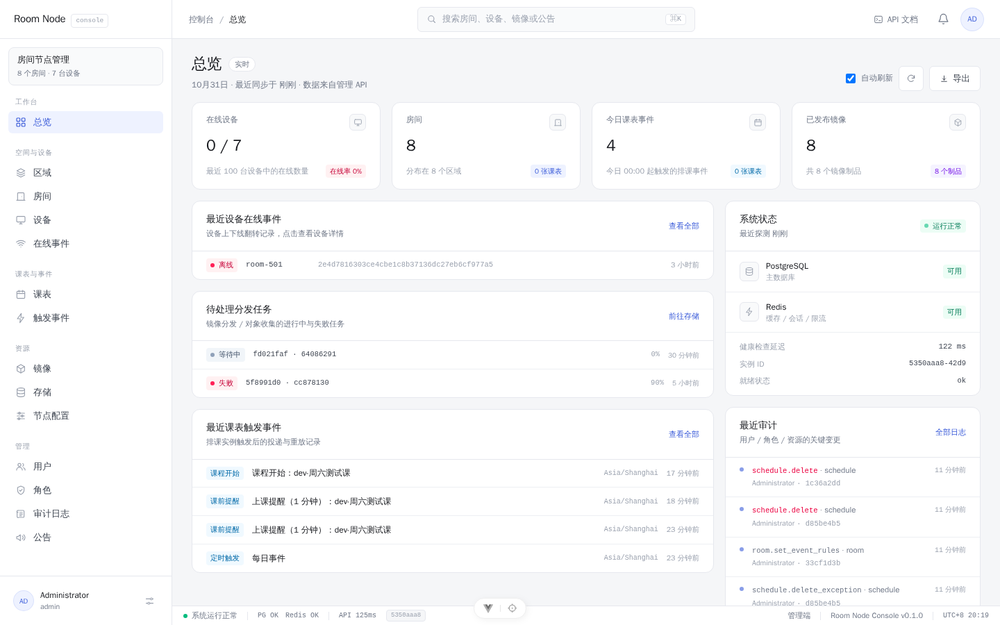
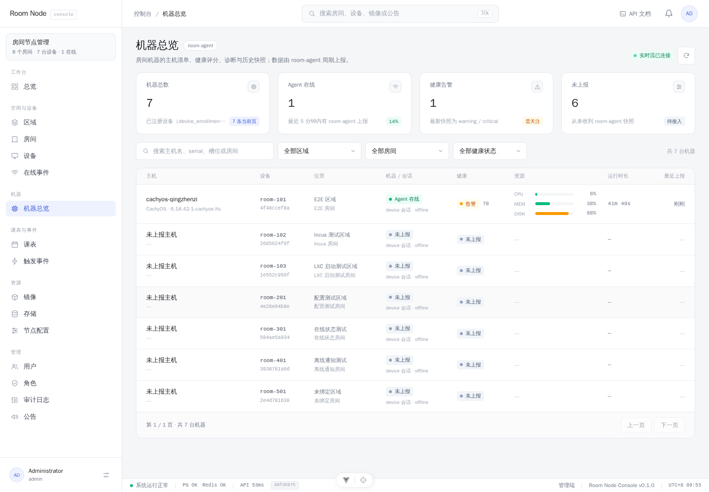

# Room Node Console

`room_node_backend` 的管理控制台：Vue 3 + Vite + Tailwind CSS 4 + Pinia，
沿用 QEStudio `frontend` 模板的视觉与交互语言（浅色桌面工作台、克制的动效、统一的表格/表单/状态胶囊），
数据层直接对接本仓库的 `/api/v1` 管理 API。

## 功能

| 区域 | 页面 | 说明 |
| --- | --- | --- |
| 工作台 | 总览 `/` | 设备在线、房间、今日课表事件、镜像等指标；最近在线事件、课表事件、审计、待处理分发任务、系统健康 |
| 空间与设备 | 区域 `/areas`、`/areas/:id` | 区域 CRUD、区域总览（房间/设备/事件/课表聚合）、时区、区域级 webhook |
| | 房间 `/rooms`、`/rooms/:id` | 房间总览（统计卡片 + 最近事件）、CRUD、设备槽位绑定/迁移/解绑、签发设备注册 token、房间课表与排课实例 |
| | 设备 `/devices`、`/devices/:serial` | 设备注册/在线状态、房间与区域、客户端信息 |
| | 在线事件 `/device-events` | 上下线事件历史、可靠投递记录、SSE 实时流 |
| | 机器 `/machines`、`/machines/:serial` | room-agent 上报的机器总览：健康评分、诊断、主机/资源/容器/虚拟机/安全核查、历史快照；进入页面自动订阅 SSE 实时流（约 15s 一帧） |
| 课表与事件 | 课表 `/schedules`、`/schedules/:id` | 周模板、单日覆盖、排课实例、手动重建 |
| | 触发事件 `/events` | 事件与投递明细、重放/重试、房间触发规则 |
| 资源 | 镜像 `/images`、`/images/:id` | 镜像制品、manifest、验证报告、发布通道、房间分配 |
| | 存储 `/storage` | 对象预签名/登记、分发任务重试、收集登记 |
| | 节点配置 `/agent-configs` | global → area → room 策略合并与二次下发 |
| 运维 | 工单 `/tickets`、`/tickets/:id` | 工单列表/新建、状态流转（认领/解决/关闭/重开/取消）、时间线与评论、关联房间/设备/机器、历史分析入口；顶栏「我的待办工单」 |
| | 工单分析 `/tickets/insights` | 近 7/30/90 天新增/解决/未关闭/MTTR/超时、纯 CSS 趋势与分类/房间/设备/处理人分布 |
| | 自动规则 `/tickets/rules` | 自动建单规则配置：阈值、优先级、区域/房间范围、启停；规则变更最迟一个 tick 生效 |
| | 可见范围 `/tickets/scopes` | 按用户配置工单可见区域（`ticket:scope:all` 不受限） |
| | 巡检计划 `/tickets/inspections` | 周期巡检机器健康、立即执行、异常自动建单、运行历史 |
| | 工单详情 P1 | 根因分类、附件上传/下载（≤20MiB）、工单设置；房间/设备/机器页「报修/建单」预填入口 |
| | 工单实时/导出 | 列表页 SSE「实时」状态与增量刷新、导出 CSV；详情页「工单设置」转派/优先级/分类 |
| 管理 | 用户 `/users` | 账号、启用状态、角色分配 |
| | 角色 `/roles` | 自定义角色、权限点 |
| | 审计 `/audit` | 管理操作日志与明细 |
| | 公告 `/announcements` | 草稿/发布/归档/置顶 |
| | 账户 `/account` | 个人资料、设备会话、邮箱验证、密码重置 |

登录使用后端 `/auth/login`；页面按 RBAC 权限点隐藏入口（`src/utils/permissions.ts`），
真正的授权仍由后端接口校验（403 会给出明确提示）。

## 界面预览






其余页面（区域总览、房间总览、设备、课表、事件、镜像、存储、用户、角色、审计、公告、节点配置、账户等）
的截图见 [`docs/screenshots/`](docs/screenshots/)。

## 开发

依赖已随仓库目录提供 `node_modules/`（本机 pnpm store 在沙箱下只读，通常不需要重新安装）。
如果确实需要重装，先设置可写的 store 目录：

```bash
pnpm install --store-dir .pnpm-store
```

启动：

```bash
# 后端（仓库根目录）
cargo run -p qe-api          # 或 ./target/debug/qe-api，默认 127.0.0.1:8080

# 前端
cd frontend
./node_modules/.bin/vite --host 127.0.0.1 --port 5174
```

Vite 开发服务器把 `/api`、`/healthz`、`/readyz` 代理到 `http://127.0.0.1:8080`
（可用 `VITE_BACKEND_ORIGIN` 覆盖）。浏览器打开 <http://127.0.0.1:5174>。

- 登录账号来自后端 `.env` 的 `BOOTSTRAP_ADMIN_USERNAME` / `BOOTSTRAP_ADMIN_PASSWORD`。
- 独立部署时用 `VITE_API_BASE_URL` 指向 API 前缀（例如 `https://api.example.com/api/v1`），
  并配置后端 `CORS_ALLOWED_ORIGINS`；健康检查走同源的 `/healthz`、`/readyz`。

常用命令（沙箱环境用本地二进制，避免 pnpm 尝试写只读缓存）：

```bash
./node_modules/.bin/vue-tsc --noEmit -p tsconfig.app.json   # 类型检查
./node_modules/.bin/vite build                              # 生产构建
./node_modules/.bin/vitest run                              # 单元测试
./node_modules/.bin/oxfmt src                               # 格式化
./node_modules/.bin/oxlint .                                # lint
```

## 结构

```text
src/
  api/               # axios 客户端、令牌与会话、OpenAPI 生成的 schema 类型
    index.ts         #   唯一请求出口：按资源分组的 api.* 方法
    schema.ts        #   由 docs/openapi.json 生成，字段与后端一致（snake_case）
    types.ts         #   查询参数/会话/探针等手写类型
  assets/main.css    # 设计令牌（@theme）与共用 .input/.table-th 等组件类
  components/
    layout/          # 侧边栏、顶栏、状态栏、通知中心
    search/          # ⌘K 全局搜索
    ui/              # 通用原语：Button/Modal/StateBadge/ConfirmDialog/JsonBlock...
  features/<domain>/ # 按业务域拆分的展示组件
  layouts/           # 路由级布局
  router/            # 路由表、登录/权限守卫、页面进度条
  stores/            # auth / shell / overview / toast / ui
  utils/             # 格式化、权限常量、错误处理
  views/             # 路由页面，只做编排
docs/
  openapi.json       # 后端 OpenAPI 3.1 规范快照
  openapi-types.py   # 从规范生成 src/api/schema.ts
  api-contract.md    # 接口清单（方法/参数/类型）
  CONVENTIONS.md     # 页面与代码约定
```

刷新 API 类型：

```bash
curl -s http://127.0.0.1:8080/api-docs/openapi.json -o docs/openapi.json
python3 docs/openapi-types.py
./node_modules/.bin/oxfmt src/api/schema.ts
```

## 认证与会话

- access token 只放内存；refresh token 按「记住这台设备」放 localStorage / sessionStorage。
- 请求拦截器附加 `Authorization: Bearer <access_token>`；401 时用 refresh token 换一次新令牌并重放请求，
  并发 401 共用同一个刷新请求（后端刷新令牌是一次性的）。
- 刷新失败或后端撤销会话时清本地会话并跳转登录页，`?redirect=` 只接受站内路径。
- 路由守卫在进入受保护页面前会重新拉取 `/auth/me`，角色/权限变更后入口即时更新。

## UI 约定

- 主题令牌集中在 `src/assets/main.css` 的 `@theme`（主色 `--color-accent`、画布 `--color-canvas` 等）。
- 页面只编排，复杂 UI 放 `features/`；可复用组件在 `components/ui/`。
- 列表页统一「PageHeader + 筛选工具栏 + 卡片表格 + PaginationBar」，处理加载/空/错误三态。
- 表单用 `AppModal + FormField`，危险操作走 `ConfirmDialog`，提示用 `ToastHost`。
- 禁止 `v-html`；公告正文以纯文本展示，避免 XSS。
- 详细规则见 [docs/CONVENTIONS.md](docs/CONVENTIONS.md)。

## 许可

MIT © 2026 QEStudio
